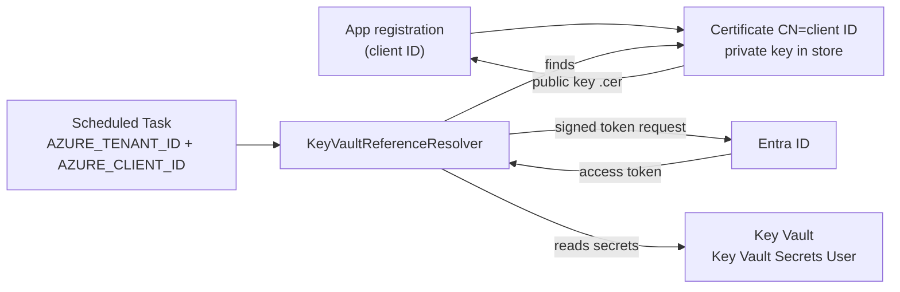

# HOWTO: Authenticate with a Client Certificate from the Windows Certificate Store

## Overview and Purpose

This guide sets up a .NET application on a Windows VM, typically a console exe running as a Scheduled Task, to read Key Vault secrets as an Entra ID **service principal**, using a **certificate in the Windows certificate store** whose private key is **non-exportable**.

It is for the situation where there is no managed identity, no `az login`, and no secret may be written to disk. Only the public key is registered in Entra ID. The private key never leaves the machine and never exists as a file, so there is nothing to leak from disk, a backup or a repository.

Azure Identity's `EnvironmentCredential` cannot do this. It only reads a certificate from a file (`AZURE_CLIENT_CERTIFICATE_PATH`), and a non-exportable certificate has no file. KeyVaultReferenceResolver therefore builds a `ClientCertificateCredential` itself from the store certificate.

Three things have to line up, and most failures come from one of them being off:

1. **The service principal** exists in Entra ID, has the certificate's *public* key registered, and holds a role on the vault.
2. **The certificate** exists, with its private key, in the store of the account that runs the application.
3. **The application** knows the tenant and client ID, and either finds the certificate by convention or is told which one.

## How It Fits Together



The resolver signs a token request with the private key (the key stays in the store and is used in place), Entra ID checks the signature against the registered public key, and the resulting access token is used against Key Vault.

## Prerequisites

- A Windows VM and the account the application runs as (referred to below as the **run-as account**).
- Permission to create an app registration in the tenant, and to assign a role on the vault.
- The Azure CLI (`az`) for the registration steps, or the Azure portal.
- A package version of KeyVaultReferenceResolver that includes client certificate support.

Fill in these values once; the commands below use them:

```powershell
$tenantId  = "<tenant id>"
$vaultId   = "<full resource id of the vault>"   # az keyvault show --name <vault> --query id -o tsv
$appName   = "my-consumer-prod"
```

## Step 1: Register the application

The certificate is named after the client ID, so the registration comes first.

```powershell
az login --tenant $tenantId
$clientId = az ad app create --display-name $appName --query appId -o tsv
az ad sp create --id $clientId
```

Keep `$clientId`. It is not a secret, but you need it in the next steps and in the application's environment.

## Step 2: Give the service principal access to the vault

Grant the least that works. Reading secrets needs only the **Key Vault Secrets User** role, scoped to the vault (or to a single secret if you can).

```powershell
az role assignment create --assignee $clientId --role "Key Vault Secrets User" --scope $vaultId
```

If the vault uses legacy access policies instead of RBAC, grant `Get` on secrets there.

## Step 3: Create the certificate

The certificate is created **on the VM, by the run-as account**, so the private key is generated in place and is never exported.

Name it with the client ID in the subject. That is what lets the resolver find it without a thumbprint. Anything that *contains* the client ID works, for example `CN=<client id>` or `CN=my-consumer-<client id>`.

### Option A: Current user store (recommended)

Run PowerShell **as the run-as account**. For a Scheduled Task that runs as a service or gMSA account, see "Running under another account" below.

```powershell
$cert = New-SelfSignedCertificate `
    -Subject "CN=$clientId" `
    -CertStoreLocation "Cert:\CurrentUser\My" `
    -KeyExportPolicy NonExportable `
    -KeyAlgorithm RSA -KeyLength 2048 `
    -HashAlgorithm SHA256 `
    -Provider "Microsoft Software Key Storage Provider" `
    -NotAfter (Get-Date).AddYears(1)

$cert.Thumbprint
```

`-KeyExportPolicy NonExportable` is the point of the exercise: the key cannot be exported, even by an administrator, through normal means. The trade-off is that the certificate cannot be moved to another machine; a new VM gets its own certificate (Step 4 again, with `--append`).

### Option B: Local machine store

Use this when several accounts on the VM must use the same certificate, or the task runs as `SYSTEM`. Run an **elevated** PowerShell:

```powershell
$cert = New-SelfSignedCertificate `
    -Subject "CN=$clientId" `
    -CertStoreLocation "Cert:\LocalMachine\My" `
    -KeyExportPolicy NonExportable `
    -KeyAlgorithm RSA -KeyLength 2048 `
    -HashAlgorithm SHA256 `
    -Provider "Microsoft Software Key Storage Provider" `
    -NotAfter (Get-Date).AddYears(1)
```

By default only `SYSTEM` and the local Administrators can read the private key. For any other run-as account, grant it **Read** on the key: open `certlm.msc`, right-click the certificate, **All Tasks**, **Manage Private Keys**, and add the account with Read permission. Without this the resolver reports that the certificate has no accessible private key.

### Running under another account

The `CurrentUser` store belongs to a specific account profile. To create a certificate for a different account, run PowerShell *as that account*, for example:

```powershell
runas /user:DOMAIN\svc-consumer powershell
```

A gMSA cannot log on interactively, so use Option B with Read access on the key for the gMSA.

### Verify it

```powershell
Get-ChildItem Cert:\CurrentUser\My |
    Where-Object Subject -like "*$clientId*" |
    Select-Object Subject, Thumbprint, NotBefore, NotAfter, HasPrivateKey
```

`HasPrivateKey` must be `True` and `NotAfter` in the future. Use `Cert:\LocalMachine\My` for Option B.

## Step 4: Register the public key with the application

Export the public part only and upload it. The `.cer` file contains no private key and can be handled freely.

```powershell
Export-Certificate -Cert $cert -FilePath ".\$appName.cer" -Type CERT
az ad app credential reset --id $clientId --cert "@$appName.cer" --append
```

`--append` keeps any certificates already registered. Without it the command replaces them, which would lock out every other machine using this app registration. The portal route is **App registrations**, your app, **Certificates & secrets**, **Certificates**, **Upload certificate**.

Delete the `.cer` afterwards if you like; it is reproducible from the store.

## Step 5: Configure and run the application

### By convention (no code, no thumbprint)

Give the application two standard environment variables and register the resolver as usual:

```powershell
# For the run-as account (or use "Machine" from an elevated prompt):
[Environment]::SetEnvironmentVariable("AZURE_TENANT_ID", $tenantId, "User")
[Environment]::SetEnvironmentVariable("AZURE_CLIENT_ID", $clientId, "User")
```

```csharp
var builder = Host.CreateApplicationBuilder(args);
builder.Configuration.AddKeyVaultReferenceResolver();   // nothing certificate-specific
```

```json
{
  "ConnectionStrings": {
    "Db": "@Microsoft.KeyVault(SecretUri=https://contoso-prod.vault.azure.net/secrets/db-connection)"
  }
}
```

The resolver searches `CurrentUser\My`, then `LocalMachine\My`, for a certificate whose subject or friendly name contains `AZURE_CLIENT_ID`. Among matches it prefers one that is currently valid and has a private key, then the one that expires last.

Rules worth knowing:

| Situation | Result |
| --- | --- |
| Matching certificate found and usable | It is used. An information record (event 1007) says so. |
| Matching certificate found but expired, not yet valid, or no private key | Setup throws an `InvalidOperationException` naming the reason. |
| No matching certificate | Convention does not apply; the default credential chain is used as before. |
| `AZURE_CLIENT_SECRET`, `AZURE_CLIENT_CERTIFICATE_PATH` or `AZURE_FEDERATED_TOKEN_FILE` is set | Convention stays out of the way. |
| `options.Credential` or `options.ClientCertificate` is set | The explicit setting wins. |
| `ExcludeEnvironmentCredential = true` | Convention is switched off. |

A scheduled task inherits the environment of its account. After changing user or machine variables, restart the task (a task that was already running keeps the old environment).

### Explicitly (fail if the certificate is missing)

The convention treats "no matching certificate" as "this feature is not in use", because `AZURE_CLIENT_ID` is also set by other mechanisms such as user-assigned managed identities. If the application must fail loudly when the certificate is absent, name it explicitly:

```csharp
builder.Configuration.AddKeyVaultReferenceResolver(o =>
{
    // Found by client ID, like the convention, but required: no match fails at setup.
    o.ClientCertificate = new CertificateStoreCredentialOptions(tenantId, clientId);

    // One store only:
    // o.ClientCertificate = new CertificateStoreCredentialOptions(tenantId, clientId, StoreLocation.LocalMachine);

    // Pinned to one certificate by thumbprint (fourth argument: StoreLocation.LocalMachine):
    // o.ClientCertificate = new CertificateStoreCredentialOptions(tenantId, clientId, thumbprint);
});
```

Without a thumbprint, the certificate is the one whose subject or friendly name contains the client ID, chosen the same way as in the convention (valid with a private key first, then the one expiring last), so renewal needs no change. A thumbprint pins one specific certificate and must be updated at every rotation; it may be pasted straight from the Certificates snap-in, where spaces, colons, hyphens and the invisible character it adds are removed.

Read the values from ordinary configuration (never from a Key Vault reference, which is not resolved yet at this point). The error when nothing matches names the client ID, the stores searched and the process user.

### Run it

```powershell
schtasks /Run /TN "MyConsumer"
```

## Step 6: Rotate the certificate

With the convention there is nothing to change in the application:

1. Create a new certificate on the VM with the same `CN=<client id>` (Step 3), well before the old one expires.
2. Upload its public key with `--append` (Step 4).
3. Restart the task. The resolver picks the valid certificate that expires last.
4. Once every machine has switched, remove the old certificate from Entra ID (portal, **Certificates & secrets**) and from the store:

```powershell
Remove-Item "Cert:\CurrentUser\My\<old thumbprint>"
```

With the explicit form, update the thumbprint in the application's configuration at step 3.

Put the expiry date in a calendar. An expired certificate stops the application at startup with a clear message, by design, but that is still an outage.

## Troubleshooting

Certificate problems surface when the resolver is created, before any vault call.

| Message or symptom | Cause | Fix |
| --- | --- | --- |
| `No client certificate whose subject or friendly name contains the client ID ...` | Explicit form without a thumbprint: no certificate names the client ID in the searched stores. | Check the subject (Step 3 verification) and that you are running as the account whose store holds it. |
| `...was not found in the My certificate store of CurrentUser (process user 'DOMAIN\user')` | Explicit form with a thumbprint. Wrong thumbprint, or the certificate is in another account's store. | Compare the user in the message with the account the task runs as; create the certificate as that account, or use the local machine store. |
| `...has no private key, or this account cannot access it` | Certificate imported without its key, or machine-store key without Read for the run-as account. | Recreate it on the VM (Step 3), or grant Read via **Manage Private Keys**. |
| `...expired on <date>` | Certificate past its end date. | Rotate (Step 6). |
| `...is not valid before <date>` | Start date in the future, or the machine clock is wrong. A small skew (5 minutes) is tolerated. | Check the VM clock and the certificate's `NotBefore`. |
| The default credential chain fails instead, and event 1007 is absent | Convention found no certificate whose subject contains `AZURE_CLIENT_ID`, or `AZURE_CLIENT_ID` is wrong, or the task does not see the variables. | Run the verification command in Step 3 as the run-as account; check the variables in the task's environment. |
| `AADSTS700027` (client assertion contains an invalid signature) | The certificate in the store is not the one registered on the app. | Upload the current public key (Step 4); check the thumbprint in the portal. |
| `AADSTS700016` (application not found in the tenant) | Wrong `AZURE_CLIENT_ID` or `AZURE_TENANT_ID`. | Correct the values. |
| `HTTP 403` from Key Vault | Authentication worked; the service principal lacks a role, or the vault firewall blocks the VM. | Step 2, and the vault network settings. |
| A timeout | Entra ID or Key Vault unreachable. Token acquisition runs inside the existing `Timeout` and `OverallTimeout`, so this fails in bounded time rather than hanging. | Check outbound access to `login.microsoftonline.com` and the vault; adjust `Timeout` if needed. |

To see which certificate was used, enable Information logging for KeyVaultReferenceResolver. Event 1007 is written when the convention selected a certificate. It carries no identifiers.

## Security Considerations

- **Scope the role narrowly.** The identity is the machine. Grant `Key Vault Secrets User` on the one vault, and use a separate app registration per environment.
- **One certificate per machine** where practical. A non-exportable key is bound to its VM, which is a feature: a stolen disk image does not yield a usable credential.
- **Do not combine mechanisms.** Setting `AZURE_CLIENT_SECRET` as well keeps the convention out of the way and puts a secret back in the environment.
- **Set `ExcludeEnvironmentCredential = true`** if the application also runs somewhere that uses managed identity, so process environment variables cannot redirect vault access. It also switches this convention off, so use the explicit `ClientCertificate` there.
- **The `.cer` file and the thumbprint are not secret.** Only the private key is, and it never leaves the store.

## Limitations

- The certificate store is a Windows feature. On other platforms the lookup works only where .NET provides a `My` store, and otherwise reports the certificate as not found.
- `EnvironmentCredential`, and therefore `DefaultAzureCredential`, cannot use a store certificate. Use `ClientCertificate` or the convention.
- The convention ignores `ManagedIdentityClientId`, `TenantId`, `AllowDeveloperCredentials` and `ExcludeEnvironmentCredential` once it has selected a certificate; the tenant comes from `AZURE_TENANT_ID`.
- Creating and exporting certificates is outside the library's scope. This guide uses standard Windows and Azure CLI tooling for that.

## Related Documents

- [Vault-Authentication-Methods.md](../Features/Vault-Authentication-Methods.md): how the credential is chosen
- [Configuration-Reference.md](Configuration-Reference.md): all options, including `ClientCertificate`
- [Environment-Deployment-Guide.md](Environment-Deployment-Guide.md): other deployment targets
- [Security-Model.md](../Architecture/Security-Model.md): why environment-driven identity is guarded
- [Logging-And-Monitoring.md](../Operations/Logging-And-Monitoring.md): event 1007
