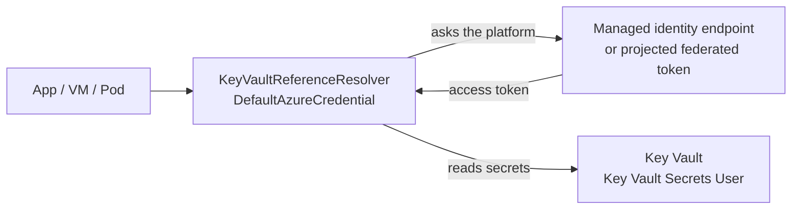

# HOWTO: Authenticate with a Managed Identity on Azure

## Overview and Purpose

This guide sets up an application that runs **in Azure** (App Service or Functions, a virtual machine, or AKS with workload identity) to read Key Vault secrets as a **managed identity**. There is no secret to store, rotate or leak: Azure issues the token to the workload, and the only thing you configure is which identity may read which vault.

It is the preferred setup in every Azure deployment. If the workload is a Windows VM with no managed identity available, use [Client-Certificate-Authentication-HOWTO.md](Client-Certificate-Authentication-HOWTO.md) instead.

Three things have to line up:

1. **The identity** exists and is attached to the compute (the app, the VM, or the Kubernetes service account).
2. **The role** `Key Vault Secrets User` is assigned to that identity on the vault.
3. **The application** is told to trust only that identity: `ExcludeEnvironmentCredential = true`, and `ManagedIdentityClientId` when more than one identity is attached.

## How It Fits Together



The library builds a `DefaultAzureCredential` with the developer credentials and the interactive browser excluded. In Azure the chain that remains is: environment credential (unless excluded), workload identity, managed identity. That is why `ExcludeEnvironmentCredential = true` matters: it removes the one link that ranks ahead of the managed identity and can be redirected by an environment variable.

## Prerequisites

- An Azure resource to run on, and permission to enable an identity on it.
- Permission to assign a role on the vault (`Owner` or `User Access Administrator` on the vault or above).
- The vault uses Azure RBAC. With legacy access policies, grant the identity `Get` on secrets there instead; a role assignment has no effect on such a vault.
- The Azure CLI (`az`) for the commands below, or the portal. The commands are shown as documentation; substitute your own subscription, resource group and names.

```powershell
$subscription  = "<subscription id>"
$resourceGroup = "<resource group>"
$vaultId       = "<full resource id of the vault>"   # az keyvault show --name <vault> --query id -o tsv
az account set --subscription $subscription
```

## Step 1: Choose the identity type

| | System-assigned | User-assigned |
| --- | --- | --- |
| Lifecycle | Created and deleted with the resource | Independent resource; outlives the app |
| Sharing | One resource only | Several resources can share one identity and one role assignment |
| Role assignments | Redone if the resource is recreated | Survive recreating the app |
| Client ID needed in the app | No | **Yes, when the host has more than one identity** (`ManagedIdentityClientId`) |

Use system-assigned when it is the only identity the host will ever have. Use user-assigned when several apps should share one role assignment, or the identity must outlive the app.

## Step 2: Attach the identity

### App Service or Functions

```powershell
# System-assigned
az webapp identity assign --name <app> --resource-group $resourceGroup
# (Functions: az functionapp identity assign ...)

# User-assigned
$identity = az identity create --name my-app-identity --resource-group $resourceGroup | ConvertFrom-Json
az webapp identity assign --name <app> --resource-group $resourceGroup --identities $identity.id
```

### Virtual machine

```powershell
az vm identity assign --name <vm> --resource-group $resourceGroup                       # system-assigned
az vm identity assign --name <vm> --resource-group $resourceGroup --identities $identity.id   # user-assigned
```

### AKS (workload identity)

A pod uses a user-assigned identity through a federated credential, tied to a Kubernetes service account. The cluster needs the OIDC issuer and workload identity enabled.

```powershell
az aks update --name <cluster> --resource-group $resourceGroup --enable-oidc-issuer --enable-workload-identity
$issuer = az aks show --name <cluster> --resource-group $resourceGroup --query oidcIssuerProfile.issuerUrl -o tsv

az identity federated-credential create `
    --name my-app-federation `
    --identity-name my-app-identity `
    --resource-group $resourceGroup `
    --issuer $issuer `
    --subject "system:serviceaccount:<namespace>:myapp" `
    --audience api://AzureADTokenExchange
```

The service account carries the identity's client ID, and the pod opts in with a label:

```yaml
apiVersion: v1
kind: ServiceAccount
metadata:
  name: myapp
  annotations:
    azure.workload.identity/client-id: "<user-assigned-identity-client-id>"
---
apiVersion: apps/v1
kind: Deployment
spec:
  template:
    metadata:
      labels:
        azure.workload.identity/use: "true"
    spec:
      serviceAccountName: myapp
```

## Step 3: Grant the role on the vault

Grant the least that works: `Key Vault Secrets User`, scoped to the vault (or to a single secret where you can).

```powershell
# $principalId is the identity's principal (object) ID: for a user-assigned identity $identity.principalId;
# for a system-assigned one, the principalId returned by the assign command in Step 2.
az role assignment create `
    --assignee-object-id $principalId `
    --assignee-principal-type ServicePrincipal `
    --role "Key Vault Secrets User" `
    --scope $vaultId
```

Role assignments can take a few minutes to propagate. If the vault's firewall is enabled, the host also needs network access to it (a selected network, trusted-service exception or private endpoint).

## Step 4: Configure the application

```csharp
var builder = WebApplication.CreateBuilder(args);

builder.Configuration.AddKeyVaultReferenceResolver(options =>
{
    // Take the identity from the platform only; never from process environment variables.
    options.ExcludeEnvironmentCredential = true;

    // Only when the host has more than one user-assigned identity attached.
    options.ManagedIdentityClientId = builder.Configuration["Azure:ManagedIdentityClientId"];

    // Resolve only against your own vault(s), not just "some Key Vault".
    options.AllowedVaultHosts = new List<string> { "contoso-prod.vault.azure.net" };
});
```

`AllowDeveloperCredentials` stays at its default of `false`, so the process cannot fall back to a developer's cached identity. Reference format and examples are in the README; configuration values look like `@Microsoft.KeyVault(SecretUri=https://contoso-prod.vault.azure.net/secrets/db-connection)`.

For AKS workload identity the same call works: the chain's workload identity step reads the projected federated token. Setting `ManagedIdentityClientId` is not needed there (the service account annotation carries the client ID).

Register the resolver **after** every source that can contain a reference, and before nothing that should shadow it. See [Production-Hardening-Checklist-HOWTO.md](../Operations/Production-Hardening-Checklist-HOWTO.md).

## Step 5: Verify

Pass an `ILogger` and start the application. With Information logging you should see:

- `ResolutionSummary` (1004): `Resolved N of N configuration value(s) containing Key Vault reference(s)`.
- `SecretRead` (1002) per secret, naming the vault but not the secret.
- **No** event 1007. That event means a store certificate was selected instead of the managed identity.

## Interaction with the store-certificate convention

The library can pick a certificate from the Windows store on its own: when `AZURE_TENANT_ID` and `AZURE_CLIENT_ID` are set **and a certificate in `CurrentUser\My` or `LocalMachine\My` has the client ID in its subject or friendly name**. `AZURE_CLIENT_ID` is also set legitimately for user-assigned identities (it can name the identity to use, and AKS workload identity injects it), so merely being set changes nothing. The convention applies only when such a certificate exists, so on a managed-identity host without one it does nothing.

It also stays out of the way when `AZURE_FEDERATED_TOKEN_FILE`, `AZURE_CLIENT_SECRET`, `AZURE_CLIENT_CERTIFICATE_PATH`, `AZURE_USERNAME` or `AZURE_PASSWORD` is set, and `ExcludeEnvironmentCredential = true` or an explicit `ManagedIdentityClientId` switches it off. Setting that option on managed-identity hosts, as above, therefore also rules out the convention.

## Troubleshooting

| Symptom | Cause | Fix |
| --- | --- | --- |
| `Access denied reading ... (HTTP 403)` | Most often the wrong identity is being used, then a missing role, then the vault firewall. | Work through the numbered list in [Troubleshooting-Guide.md](../Operations/Troubleshooting-Guide.md); check the role assignment on the vault and `ExcludeEnvironmentCredential`. |
| 403, and the host has two identities | The credential cannot choose between them. | Set `ManagedIdentityClientId` to the user-assigned identity's client ID. |
| 403 right after granting the role | Propagation delay. | Wait a few minutes and restart. |
| 403 with a role in place, vault uses access policies | Role assignments are ignored by access-policy vaults. | Add a `Get` secret access policy for the identity. |
| `Vault host '...' is not listed in KeyVaultReferenceResolverOptions.AllowedVaultHosts` | `AllowedVaultHosts` does not contain the vault named in the reference. | Add the exact host, or correct the reference. |
| A stale `AZURE_CLIENT_SECRET` app setting is the identity in use | `ExcludeEnvironmentCredential` is `false` (the default) and App Service exposes application settings as environment variables. | Set `ExcludeEnvironmentCredential = true` and remove the setting. |
| Timeout | Endpoint or vault unreachable. Token acquisition runs inside `Timeout` and `OverallTimeout`. | Check the vault firewall and outbound access; on the Consumption plan keep `OverallTimeout` inside the platform's startup budget. |
| Workload identity: no token | Service account not annotated, pod label missing, or federated credential subject does not match `system:serviceaccount:<namespace>:<name>`. | Compare the three; the subject must match exactly. |

## Security Considerations

- **`ExcludeEnvironmentCredential = true`** on every managed-identity host. Anything able to set `AZURE_CLIENT_ID`, `AZURE_TENANT_ID` or `AZURE_CLIENT_SECRET` in the process environment would otherwise redirect vault access to an identity of its choosing. The default is `false` only for backwards compatibility.
- **`AllowedVaultHosts`** pins resolution to your vaults. The default suffix list only establishes that a host is *a* Key Vault, not whose.
- **Scope the role narrowly**: one vault, `Key Vault Secrets User`, one identity per application and environment.
- **Do not combine mechanisms.** Leaving a client secret in the environment next to a managed identity puts a secret back that this setup exists to remove.
- See [Security-Model.md](../Architecture/Security-Model.md) for the reasoning behind each control.

## Limitations

- Needs a platform that provides a managed identity or a federated token. Elsewhere use a service principal with a certificate or a federated credential.
- Setting `options.Credential` replaces all of the above: `ManagedIdentityClientId`, `ExcludeEnvironmentCredential`, `TenantId`, `AuthorityHost` and `AllowDeveloperCredentials` are then ignored.
- Secrets are resolved once, at configuration build time. A rotated secret reaches the application on restart (see [Secret-Caching-And-Rotation.md](../Features/Secret-Caching-And-Rotation.md)).

## Related Documents

- [Environment-Deployment-Guide.md](Environment-Deployment-Guide.md): all deployment targets, with recommended settings per environment
- [Configuration-Reference.md](Configuration-Reference.md): every option
- [Vault-Authentication-Methods.md](../Features/Vault-Authentication-Methods.md): how the credential is chosen
- [Troubleshooting-Guide.md](../Operations/Troubleshooting-Guide.md): the 403 checklist
- [Client-Certificate-Authentication-HOWTO.md](Client-Certificate-Authentication-HOWTO.md): the alternative where no managed identity exists
