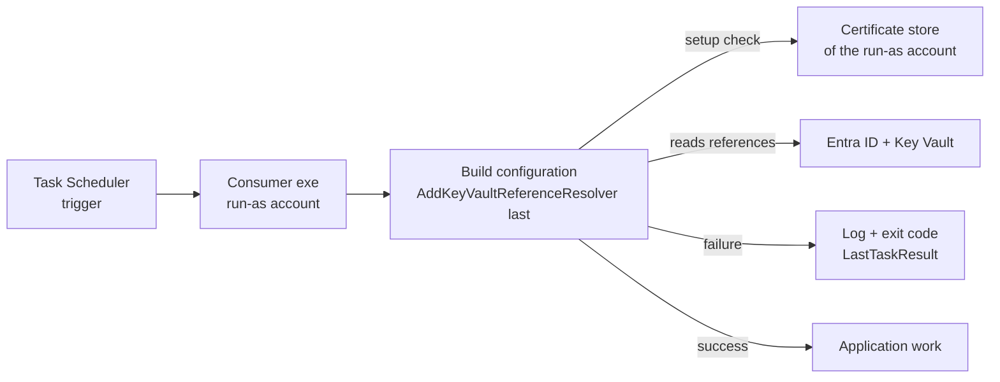

# HOWTO: Deploy a .NET Console Consumer as a Windows Scheduled Task

## Overview and Purpose

This guide deploys a .NET console application that reads its configuration through KeyVaultReferenceResolver and runs unattended as a Windows Scheduled Task. It covers the decisions that are specific to that setup: which account runs the task (this decides which certificate store is used), where the identity variables go, how startup failures show up, and how to make the task survive a vault that is briefly unreachable.

Every start of the consumer depends on the vault. The resolver reads all references while the configuration is built, so a problem with the identity, the certificate or the vault is a **startup failure**: the exe ends before it does any work. Scheduled Tasks have no console, no operator and, by default, no retry for that case. The sections below make that failure visible and recoverable.

The identity part is covered in [Client-Certificate-Authentication-HOWTO.md](Client-Certificate-Authentication-HOWTO.md). This guide assumes the app registration, role assignment and certificate exist.

## How It Fits Together



## Prerequisites

- An app registration with the certificate's public key registered, and `Key Vault Secrets User` on the vault.
- The consumer published for the VM's architecture. The library is AnyCPU, so both `win-x64` and `win-x86` hosts work.
- Administrator rights on the VM to register the task and, for service accounts, to set machine-wide variables.

## Step 1: Choose the account that runs the task

The account decides **which certificate store holds the certificate**, and therefore how the certificate is created and where the environment variables are set.

| Run-as account | Certificate store | Environment variables | Notes |
| --- | --- | --- | --- |
| A dedicated domain or local user | `CurrentUser\My` of that user | `User` scope of that user | Recommended. Create the certificate while signed in as that user (see the client certificate HOWTO). |
| A gMSA | `LocalMachine\My`, with Read on the private key for the gMSA | `Machine` scope | A gMSA cannot sign in interactively, so a per-user certificate cannot be created by hand. |
| `SYSTEM` | `LocalMachine\My` | `Machine` scope | `SYSTEM` has its own separate user store, so use the machine store. Broadest privileges, so least preferred. |

The resolver searches `CurrentUser\My` first and then `LocalMachine\My`, so the same application works with either. A certificate in the wrong account's store is the most common cause of "certificate not found" on a VM where `Get-ChildItem` shows it fine under your own login.

Use a dedicated account per application and grant it only what it needs: log on as a batch job, read access to the application folder, write access to its working and log folders.

## Step 2: Publish the application

```powershell
dotnet publish -c Release -r win-x64 --no-self-contained -o C:\Apps\MyConsumer
```

Use `-r win-x86` for a 32-bit host. `--no-self-contained` expects the .NET 8 runtime to be installed on the VM; omit it to publish the runtime with the application.

## Step 3: Wire up configuration and logging

Register the resolver **after every other configuration source**, and pass a logger. Catch the startup failure yourself, so the task ends with an exit code you chose and the cause is logged.

```csharp
using Microsoft.Extensions.Configuration;
using Microsoft.Extensions.Logging;
using KeyVaultReferenceResolver;

// Configure a provider that survives the task: a file or the Windows event log.
// Task Scheduler discards console output.
ILogger logger = /* your ILoggerFactory.CreateLogger("Startup") */;

IConfigurationRoot configuration;
try
{
    configuration = new ConfigurationBuilder()
        .AddJsonFile("appsettings.json", optional: false)
        .AddEnvironmentVariables()
        .AddKeyVaultReferenceResolver(new KeyVaultReferenceResolverOptions(), logger)   // last
        .Build();
}
catch (Exception ex)
{
    logger.LogCritical(ex, "Configuration could not be built; the vault or the identity is not usable.");
    return 10;
}

// ... application work ...
return 0;
```

```json
{
  "ConnectionStrings": {
    "Db": "@Microsoft.KeyVault(SecretUri=https://contoso-prod.vault.azure.net/secrets/db-connection)"
  }
}
```

**The register-last rule.** The resolver scans only the sources registered before it, and resolution happens once, when `AddKeyVaultReferenceResolver` is called. A source added afterwards is never resolved. If such a source still carries a literal `@Microsoft.KeyVault(...)` value, the application fails to build the configuration with a `KeyVaultReferenceResolutionException` that starts with "Configuration source(s) registered after AddKeyVaultReferenceResolver carry unresolved reference(s) for: ..." (log events 1005 and 1006). A later source that holds ordinary values, such as `AddCommandLine` to override a setting, is allowed.

Passing a logger matters: without one the library logs to `NullLogger` and the log shows nothing. The records worth keeping are the failure (1003), the summary (1004, "Resolved N of M ...") and, when the environment convention is used, 1007. See [Logging-And-Monitoring.md](../Operations/Logging-And-Monitoring.md).

## Step 4: Set the identity variables

For the environment convention, the process needs `AZURE_TENANT_ID` and `AZURE_CLIENT_ID`, and a certificate whose subject contains the client ID. They are identifiers, not secrets.

For a dedicated user account, set them for that user, signed in as that user:

```powershell
[Environment]::SetEnvironmentVariable("AZURE_TENANT_ID", $tenantId, "User")
[Environment]::SetEnvironmentVariable("AZURE_CLIENT_ID", $clientId, "User")
```

For a gMSA or `SYSTEM`, from an elevated prompt:

```powershell
[Environment]::SetEnvironmentVariable("AZURE_TENANT_ID", $tenantId, "Machine")
[Environment]::SetEnvironmentVariable("AZURE_CLIENT_ID", $clientId, "Machine")
```

Each start of the task builds a fresh environment, so a changed variable is picked up the next time the task starts, without signing out. A run that is already in progress keeps the values it started with.

If you prefer the explicit form, put the three values in `appsettings.json` and set `ClientCertificate` in code; no environment variables are needed then. See the client certificate HOWTO.

## Step 5: Register the task

For a dedicated user, interactive logon type (this form is for a user signed in on the VM):

```powershell
$action    = New-ScheduledTaskAction -Execute "C:\Apps\MyConsumer\MyConsumer.exe" `
                 -WorkingDirectory "C:\Apps\MyConsumer"
$trigger   = New-ScheduledTaskTrigger -Daily -At 2am
$principal = New-ScheduledTaskPrincipal -UserId "DOMAIN\svc-consumer" -LogonType Interactive -RunLevel Limited
$settings  = New-ScheduledTaskSettingsSet `
                 -StartWhenAvailable `
                 -RunOnlyIfNetworkAvailable `
                 -MultipleInstances IgnoreNew `
                 -ExecutionTimeLimit (New-TimeSpan -Minutes 30)

Register-ScheduledTask -TaskName "MyConsumer" -Action $action -Trigger $trigger `
    -Principal $principal -Settings $settings
```

To run whether or not the user is signed in, give the task the account's password at registration:

```powershell
$cred = Get-Credential "DOMAIN\svc-consumer"
Register-ScheduledTask -TaskName "MyConsumer" -Action $action -Trigger $trigger -Settings $settings `
    -User $cred.UserName -Password $cred.GetNetworkCredential().Password
```

For a gMSA (no password) or `SYSTEM`:

```powershell
$gmsa   = New-ScheduledTaskPrincipal -UserId 'DOMAIN\gmsa-consumer$' -LogonType Password
$system = New-ScheduledTaskPrincipal -UserId "SYSTEM" -LogonType ServiceAccount -RunLevel Highest
Register-ScheduledTask -TaskName "MyConsumer" -Action $action -Trigger $trigger `
    -Principal $gmsa -Settings $settings        # or -Principal $system
```

What the settings do:

| Setting | Why |
| --- | --- |
| `-StartWhenAvailable` | Runs a missed start (VM was off) as soon as possible. |
| `-RunOnlyIfNetworkAvailable` | Does not start when no network connection is up, which would fail at the vault anyway. |
| `-MultipleInstances IgnoreNew` | A slow run does not stack a second instance on top of itself. |
| `-ExecutionTimeLimit` | Ends a hung run. Set it **above** the application's own time plus the resolver's `OverallTimeout` (see below). |

Run it once by hand to check, then read the result:

```powershell
Start-ScheduledTask -TaskName "MyConsumer"
Get-ScheduledTaskInfo -TaskName "MyConsumer" | Select-Object LastRunTime, LastTaskResult
```

## Step 6: Understand the failure behaviour

### Which exception, in which order

Everything the resolver checks happens while the configuration is built, in this order:

1. **Certificate checks** (explicit `ClientCertificate`, or a certificate found by convention). Missing, no private key, expired, or not yet valid throws an `InvalidOperationException` from `AddKeyVaultReferenceResolver`, **before any vault call**. The message names the thumbprint, the store, the process user and, where relevant, the date.
2. **Vault reads.** Each reference is read under the per-secret `Timeout`. Any failure, whether authentication, authorisation, a missing secret or a timeout, is wrapped in a `KeyVaultReferenceResolutionException` with the generic message `Failed to resolve Key Vault reference for configuration key '<key>'`. The real cause is in its `InnerException`. The first failure is thrown, because `ThrowOnResolveFailure` defaults to `true`.
3. **Registration order.** A later source carrying an unresolved reference throws a `KeyVaultReferenceResolutionException` when the configuration is built.

When `ThrowOnResolveFailure` is `false`, a failed key is set to `null` and the application starts. That hides the failure; the log (1003, 1004 with `Count < Total`) is then the only signal. Leave it on for a task that cannot work without its secrets.

### What the task result shows

An unhandled exception ends the process with exit code `0xE0434352` (`-532462766`), which is what `LastTaskResult` shows, and writes a `.NET Runtime` event 1026 to the Windows **Application** log with the stack trace. If you catch the exception as in Step 3 and return your own code, `LastTaskResult` shows that code instead, and your log carries the full exception chain (event 1003 for vault failures).

Pick distinct exit codes so a monitor can tell failures apart, for example `10` for "configuration could not be built" and `20` for application errors.

### Restart settings do not retry a non-zero exit code

`-RestartCount` and `-RestartInterval` ("if the task fails, restart every...") do **not** re-run a task whose program exits with a non-zero code. A consumer that exits `10` because the vault was briefly unreachable stays failed until its next trigger. To get a retry, use one of:

- **A repeating trigger**, with `IgnoreNew` so runs do not overlap. The consumer must be safe to start repeatedly, for example by exiting quickly when there is nothing to do:

  ```powershell
  $trigger = New-ScheduledTaskTrigger -Once -At "02:00" `
      -RepetitionInterval (New-TimeSpan -Minutes 15) -RepetitionDuration (New-TimeSpan -Hours 1)
  ```

- **A retry loop in the consumer** around building the configuration, with a pause between attempts, bounded so it still ends within `-ExecutionTimeLimit`. Only retry for the vault-unreachable cases (a `TimeoutException`, or an `OperationCanceledException` when the `OverallTimeout` budget ran out, or HTTP 429 or 5xx, in the inner exception). Certificate errors and `403` will not fix themselves.

### Timeouts

These are the defaults, set on `KeyVaultReferenceResolverOptions`:

| Option | Default | Meaning |
| --- | --- | --- |
| `Timeout` | 30 seconds | Per secret. Token acquisition from Entra ID runs inside it, so an unreachable Entra ID or vault ends as a timeout rather than a hang. |
| `OverallTimeout` | 2 minutes | Total budget for resolving every reference at startup. |
| `MaxConcurrency` | 8 | Secrets read in parallel. |

With the defaults, an unreachable vault makes the startup fail after at most about two minutes, whatever the number of references. Set `-ExecutionTimeLimit` comfortably above that plus the application's own run time, and if you retry inside the consumer, count `OverallTimeout` once per attempt. Raise `Timeout` only if the vault is genuinely slow to answer; `Timeout` also bounds the Azure SDK's own retries for that secret.

## Troubleshooting

| Symptom | Cause | Fix |
| --- | --- | --- |
| `LastTaskResult` is `0xE0434352` | Unhandled exception in the consumer. | Read the Application log (`.NET Runtime`, event 1026); catch and log at startup as in Step 3. |
| "Certificate not found" only when run by the task | The task's account has a different `CurrentUser` store than the account you tested with. | Create the certificate as the run-as account, or use `LocalMachine` with Read on the key. |
| "has no private key, or this account cannot access it" | Machine-store key without Read for the run-as account. | Grant the account Read on the key (see the client certificate HOWTO, Option B). |
| Convention not applied, default chain errors instead | `AZURE_CLIENT_ID` or `AZURE_TENANT_ID` is not in the task's environment, or no certificate subject contains the client ID. | Set the variables for the right scope (Step 4); check the subject. |
| Variable changes have no effect | The task run was already in progress, or the variable was set for another scope or account. | Start the task again; check `User` versus `Machine` scope. |
| The task does not retry after a failed start | Restart settings ignore non-zero exit codes. | Use a repeating trigger or an in-app retry (Step 6). |
| The task stops mid-run | `-ExecutionTimeLimit` is shorter than the run. | Raise it above the application time plus `OverallTimeout`. |
| "Configuration source(s) registered after AddKeyVaultReferenceResolver carry unresolved reference(s)" | A source with a reference was added after the resolver. | Move `AddKeyVaultReferenceResolver` last. |
| Nothing in the log | No logger was passed, or the provider writes to the console. | Pass an `ILogger`; use a file or event-log provider. |

For failures between the app and Entra ID or the vault, see [Diagnose-Authentication-Failures-HOWTO.md](../Operations/Diagnose-Authentication-Failures-HOWTO.md).

## Security Considerations

- **A dedicated account per application**, with only the rights the task needs. The account is the identity boundary on the VM: whoever can run code as it can use its certificate.
- **No secrets in the task definition.** The task needs only identifiers (`AZURE_TENANT_ID`, `AZURE_CLIENT_ID`). Avoid putting `AZURE_CLIENT_SECRET` anywhere; when set, it also switches the environment convention off.
- **Registering with a password** stores the credential in Windows. Prefer a gMSA, which has no password to manage.
- **Protect the application folder.** The exe and `appsettings.json` should not be writable by the run-as account or by other users, or the task becomes a way to run arbitrary code as that identity.
- **Logs.** The library keeps secret names out of its Information records. Debug level (event 1001) names secrets, so do not enable it in production.

## Limitations

- Task Scheduler's restart-on-failure does not retry a non-zero exit code, as described above. Retry has to come from a repeating trigger or from the application.
- The gMSA and `SYSTEM` variants rely on the machine certificate store, and the gMSA needs Read on the private key. Run-as-user variants rely on that user's profile being available to the task.
- The resolver reads references once, at startup. A secret rotated in the vault is picked up on the next start, not while the task runs. For a long-running process see [Secret-Caching-And-Rotation.md](../Features/Secret-Caching-And-Rotation.md).

## Related Documents

- [Client-Certificate-Authentication-HOWTO.md](Client-Certificate-Authentication-HOWTO.md): identity, certificate and convention
- [Certificate-Rotation-And-Expiry-Monitoring-HOWTO.md](../Operations/Certificate-Rotation-And-Expiry-Monitoring-HOWTO.md): replacing the certificate
- [Diagnose-Authentication-Failures-HOWTO.md](../Operations/Diagnose-Authentication-Failures-HOWTO.md): when startup fails
- [Configuration-Reference.md](Configuration-Reference.md): `Timeout`, `OverallTimeout`, `ThrowOnResolveFailure`
- [Troubleshooting-Guide.md](../Operations/Troubleshooting-Guide.md): exception and message catalogue
- [Logging-And-Monitoring.md](../Operations/Logging-And-Monitoring.md): event IDs
