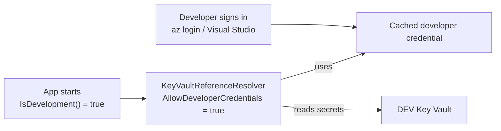

# HOWTO: Develop Locally Without Secrets

## Overview and Purpose

This guide sets up a developer machine so an application that uses KeyVaultReferenceResolver can read secrets from a **dev** vault, with no secret in source control, in `appsettings.Development.json`, in user secrets or in an environment variable. The developer signs in once with their own account (`az login`, Visual Studio, or similar), and the library uses that cached identity.

The same code is safe in production: the option that enables developer credentials is tied to the hosting environment, and it is `false` by default.

Three things to get right:

1. **Enable developer credentials in development only**, with `AllowDeveloperCredentials = builder.Environment.IsDevelopment()`.
2. **Point the developer identity at a dev vault**, never production.
3. **Keep production vault URIs out of the files a developer runs with.**

## How It Fits Together



## Prerequisites

- .NET SDK, and one signed-in developer tool: the Azure CLI (`az login`), the Azure Developer CLI (`azd auth login`), Visual Studio (Azure service authentication) or Azure PowerShell (`Connect-AzAccount`).
- A dev Key Vault, and a role assignment for the developer (or for a developer group) on that vault only.

```powershell
# Documentation only: substitute your own values. Grants read access on the DEV vault.
az role assignment create `
    --assignee "<developer or group object id>" `
    --role "Key Vault Secrets User" `
    --scope "<full resource id of the DEV vault>"
```

## Step 1: Enable developer credentials in development only

```csharp
var builder = WebApplication.CreateBuilder(args);

builder.Configuration.AddKeyVaultReferenceResolver(options =>
{
    options.AllowDeveloperCredentials = builder.Environment.IsDevelopment();
});
```

`AllowDeveloperCredentials` defaults to `false`. When `true`, the Azure CLI, Azure Developer CLI, Visual Studio and Azure PowerShell credentials are allowed into the credential chain. Interactive browser sign-in is always excluded. Because `IsDevelopment()` is `false` in staging and production, a process running in Azure cannot silently fall back to a developer's personal identity.

Keep `ThrowOnResolveFailure` at its default of `true`. Turning it off to work offline produces `null` configuration values and a confusing cascade of downstream errors. For offline work use a stub `ISecretResolver` or a local-only configuration source (see [Local-Setup-And-Testing.md](Local-Setup-And-Testing.md)).

## Step 2: Sign in

Pick one tool and sign in with the account that has a role on the dev vault:

```powershell
az login --tenant <tenant id>
# or: azd auth login
# or: Connect-AzAccount -Tenant <tenant id>
# Visual Studio: Tools > Options > Azure Service Authentication
```

Name the tenant when you have access to several, so the token is issued for the right one.

## Step 3: Keep production vault URIs out of development

The reference names the vault, so the file the developer runs with decides which vault is contacted. Put the dev vault in `appsettings.Development.json` and the production vault only in files and sources that are used in production:

```json
// appsettings.Development.json
{
  "ConnectionStrings": {
    "Db": "@Microsoft.KeyVault(SecretUri=https://contoso-dev.vault.azure.net/secrets/db-connection)"
  }
}
```

```json
// production only: deployment pipeline, app settings, or a production appsettings file
{
  "ConnectionStrings": {
    "Db": "@Microsoft.KeyVault(SecretUri=https://contoso-prod.vault.azure.net/secrets/db-connection)"
  }
}
```

Use the same secret **names** in both vaults, so only the host differs. As a guard, restrict what the development build may contact:

```csharp
builder.Configuration.AddKeyVaultReferenceResolver(options =>
{
    options.AllowDeveloperCredentials = builder.Environment.IsDevelopment();

    if (builder.Environment.IsDevelopment())
        options.AllowedVaultHosts = new List<string> { "contoso-dev.vault.azure.net" };
});
```

With `AllowedVaultHosts` set, a reference to any other vault (including production) fails with `Vault host '...' is not listed in KeyVaultReferenceResolverOptions.AllowedVaultHosts`, before any request is made. The reverse is the production list from [Production-Hardening-Checklist-HOWTO.md](../Operations/Production-Hardening-Checklist-HOWTO.md).

Register the resolver after the sources that carry references (`appsettings.json`, `appsettings.Development.json`), and before nothing that should override them. `WebApplication.CreateBuilder` registers its default sources first, so calling `AddKeyVaultReferenceResolver` on `builder.Configuration` there is correct.

## Step 4: Check AZURE_* variables on your machine

The default credential chain and one convention read `AZURE_*` environment variables, and they can override the developer sign-in without you noticing.

| Variable present | Effect |
| --- | --- |
| `AZURE_CLIENT_ID`, `AZURE_TENANT_ID`, `AZURE_CLIENT_SECRET` | The environment credential sits ahead of the developer credentials and is used instead of your sign-in (unless `ExcludeEnvironmentCredential = true`). A leftover value from another project is a common cause of unexpected 403s. |
| `AZURE_TENANT_ID` and `AZURE_CLIENT_ID`, and a certificate in your `CurrentUser\My` or `LocalMachine\My` whose subject or friendly name contains the client ID | The store-certificate convention takes over instead of your sign-in, and an information record (event 1007) is logged. |
| Either set, with no matching certificate and no client secret | Nothing changes for the convention; `AZURE_CLIENT_ID` can still name a user-assigned identity for managed identity (not relevant on a laptop). |
| `AZURE_CLIENT_SECRET`, `AZURE_CLIENT_CERTIFICATE_PATH` or `AZURE_FEDERATED_TOKEN_FILE` | The convention stays out of the way. |

To see what is set:

```powershell
Get-ChildItem Env:AZURE_* | Select-Object Name   # names only; do not print values into logs or tickets
```

If you want developer sign-in to win regardless of the environment, set `ExcludeEnvironmentCredential = true` in development as well. That also switches the certificate convention off.

## Step 5: Verify

Pass an `ILogger` and start the application. You should see `ResolutionSummary` (1004) reporting `Resolved N of N`, and `SecretRead` (1002) per secret. Enable `Debug` temporarily to see which secret names are being read (event 1001), and turn it off afterwards: those records name secrets.

## Troubleshooting

| Symptom | Cause | Fix |
| --- | --- | --- |
| `Access denied reading ... (HTTP 403)` | The developer identity has no role on the dev vault, or a stray `AZURE_*` variable changed which identity is used. | Check the role assignment and Step 4. |
| `DefaultAzureCredential failed to retrieve a token` listing every credential | Nobody is signed in, or `AllowDeveloperCredentials` is `false` (for example `ASPNETCORE_ENVIRONMENT` is not `Development`). | Sign in (Step 2); check the environment name. |
| Works in Visual Studio, fails from the command line (or the reverse) | Different cached credential, possibly a different tenant or account. | Sign in with the tool you actually run from, naming the tenant. |
| `Vault host '...' is not listed in ...AllowedVaultHosts` | A reference points at a vault outside the development allow list. | Correct the reference or the list. |
| A configuration value is `null` | The reference could not be resolved; the library fails closed. | Read the `Error` record (1003) for the key and cause. |
| The value still contains `@Microsoft.KeyVault(...)` | Another source was registered after the resolver and overrides it. | Register the resolver last; look for event 1005. |

More in [Troubleshooting-Guide.md](../Operations/Troubleshooting-Guide.md).

## Security Considerations

- **A developer identity is usually far more privileged than a workload's**, and its use is harder to attribute in an audit. Scope it to the dev vault with `Key Vault Secrets User`, not to a subscription.
- **Never grant developers production secret access** for convenience. If a production secret is needed to reproduce a problem, use a controlled, logged process.
- **Do not paste secrets into `appsettings.Development.json`, user secrets or environment variables** to avoid signing in. The point of this setup is that none exist on the machine.
- **Do not paste values into tickets or chat.** Debug logging names secrets; do not enable it outside your machine.

## Limitations

- Needs network access to the dev vault and a signed-in tool. For offline work use `FakeSecretResolver`-style stubs (see [Local-Setup-And-Testing.md](Local-Setup-And-Testing.md)), not `ThrowOnResolveFailure = false`.
- Developer credentials are not a CI mechanism. In pipelines prefer a federated credential or a stub resolver.
- `AllowDeveloperCredentials` is ignored when `options.Credential` or `options.ClientCertificate` is set.

## Related Documents

- [Environment-Deployment-Guide.md](../Deployment/Environment-Deployment-Guide.md): the other environments
- [Local-Setup-And-Testing.md](Local-Setup-And-Testing.md): building the repository, test doubles
- [Managed-Identity-HOWTO.md](../Deployment/Managed-Identity-HOWTO.md): the production counterpart in Azure
- [Production-Hardening-Checklist-HOWTO.md](../Operations/Production-Hardening-Checklist-HOWTO.md): what to set before going live
- [Troubleshooting-Guide.md](../Operations/Troubleshooting-Guide.md)
