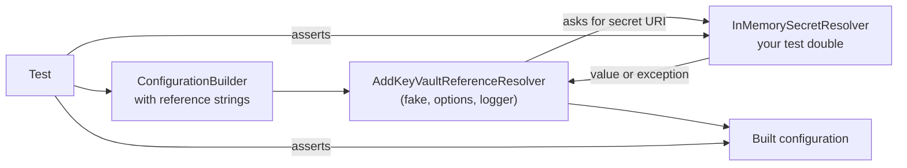

# HOWTO: Unit Test an Application That Uses KeyVaultReferenceResolver

## Overview and Purpose

This guide shows how to test code that depends on KeyVaultReferenceResolver without a vault, a credential or a network: the configuration that holds `@Microsoft.KeyVault(...)` references, and classes that resolve secrets themselves.

The seam is `ISecretResolver`. It has two members (`ResolveSecretAsync` and `ResolveSecret`), so a test double is a few lines. The repository has a ready-made `FakeSecretResolver`, but it lives in `tests/KeyVaultReferenceResolver.TestSupport`, which is never packed, so a consumer cannot reference it. That is deliberate: a resolver that can return an empty string for an unknown secret has no place in a shipped assembly, where a wiring mistake could start an application with empty passwords. Write the double in your own test project, as shown below.

With a fake `ISecretResolver` passed to `AddKeyVaultReferenceResolver`, no credential is built and nothing can reach Azure, because the real resolver is never created.

## How It Fits Together



The pipeline finds references, converts both reference formats to a canonical secret URI, deduplicates, and asks the resolver for each URI. Your double is keyed by those URIs, for example `https://myvault.vault.azure.net/secrets/db-connection`.

## Prerequisites

- A test project with xUnit (the examples use xUnit v3 and plain `Assert`, no FluentAssertions).
- A reference to the `KeyVaultReferenceResolver` package, the same version the application uses.

## Step 1: Write the test double

```csharp
using KeyVaultReferenceResolver;

namespace MyApp.Tests;

/// <summary>
/// A minimal ISecretResolver for tests, keyed by the canonical secret URI.
/// Lives in the consumer's own test project, never in production code.
/// </summary>
public sealed class InMemorySecretResolver : ISecretResolver
{
    private readonly Dictionary<string, string> _secrets;
    private int _calls;

    public InMemorySecretResolver(Dictionary<string, string>? secrets = null)
    {
        _secrets = secrets ?? new Dictionary<string, string>();
    }

    /// <summary>How many times the resolver was asked for a secret.</summary>
    public int Calls => Volatile.Read(ref _calls);

    public string ResolveSecret(string secretUri)
    {
        // Resolution runs several lookups in parallel, hence the Interlocked.
        Interlocked.Increment(ref _calls);

        // Throw for an unknown secret rather than returning "": an empty string would hide a
        // missing secret, which is exactly what the real resolver refuses to do.
        return _secrets.TryGetValue(secretUri, out var value)
            ? value
            : throw new KeyNotFoundException("No such secret in the test double.");
    }

    public Task<string> ResolveSecretAsync(string secretUri, CancellationToken cancellationToken = default)
        => Task.FromResult(ResolveSecret(secretUri));
}
```

Two design points. The call counter is how a test proves the fake was the only thing consulted. And an unknown secret throws instead of returning an empty string: the pipeline treats a thrown exception as a failed resolution, which is what you want to exercise.

## Step 2: Test the configuration

`AddKeyVaultReferenceResolver(ISecretResolver, options, logger)` resolves references immediately, while the builder is being configured, so a failure is thrown from that call, not from `Build()`.

```csharp
using KeyVaultReferenceResolver;
using Microsoft.Extensions.Configuration;
using Xunit;

namespace MyApp.Tests;

public class ConfigurationTests
{
    private const string DbUri = "https://myvault.vault.azure.net/secrets/db-connection";
    private const string DbRef = "@Microsoft.KeyVault(SecretUri=" + DbUri + ")";

    private static IConfigurationBuilder BuilderWith(params (string Key, string Value)[] values) =>
        new ConfigurationBuilder().AddInMemoryCollection(
            values.ToDictionary(v => v.Key, v => (string?)v.Value));

    [Fact]
    public void Reference_IsReplacedByTheSecret()
    {
        var resolver = new InMemorySecretResolver(new() { [DbUri] = "Server=db;Password=s3cret" });

        var configuration = BuilderWith(("ConnectionStrings:Db", DbRef))
            .AddKeyVaultReferenceResolver(resolver, options: null, logger: null)
            .Build();

        Assert.Equal("Server=db;Password=s3cret", configuration["ConnectionStrings:Db"]);
        Assert.Equal(1, resolver.Calls);
        configuration.AssertNoUnresolvedReferences();
    }

    [Fact]
    public void TwoKeysForOneSecret_AreFetchedOnce()
    {
        var resolver = new InMemorySecretResolver(new() { [DbUri] = "pw" });

        BuilderWith(("A", DbRef), ("B", "@Microsoft.KeyVault(VaultName=myvault;SecretName=db-connection)"))
            .AddKeyVaultReferenceResolver(resolver, options: null, logger: null);

        Assert.Equal(1, resolver.Calls);
    }

    [Fact]
    public void MissingSecret_ThrowsByDefault_NamingTheConfigurationKey()
    {
        var resolver = new InMemorySecretResolver();

        var ex = Assert.Throws<KeyVaultReferenceResolutionException>(() =>
            BuilderWith(("ConnectionStrings:Db", DbRef))
                .AddKeyVaultReferenceResolver(resolver, options: null, logger: null));

        Assert.Equal("ConnectionStrings:Db", ex.ConfigurationKey);
    }

    [Fact]
    public void MissingSecret_WithThrowOffYieldsNull_NeverTheLiteralReference()
    {
        var resolver = new InMemorySecretResolver();
        var options = new KeyVaultReferenceResolverOptions { ThrowOnResolveFailure = false };

        var configuration = BuilderWith(("ConnectionStrings:Db", DbRef))
            .AddKeyVaultReferenceResolver(resolver, options, logger: null)
            .Build();

        Assert.Null(configuration["ConnectionStrings:Db"]);
    }

    [Fact]
    public void NoReferences_MeansNoLookupAtAll()
    {
        var resolver = new InMemorySecretResolver();

        var configuration = BuilderWith(("Plain", "value"))
            .AddKeyVaultReferenceResolver(resolver, options: null, logger: null)
            .Build();

        Assert.Equal("value", configuration["Plain"]);
        Assert.Equal(0, resolver.Calls);
    }

    [Fact]
    public void ASourceRegisteredAfterTheResolver_WithAReference_FailsBuild()
    {
        var resolver = new InMemorySecretResolver(new() { [DbUri] = "pw" });

        var builder = BuilderWith(("Plain", "value"))
            .AddKeyVaultReferenceResolver(resolver, options: null, logger: null)
            .AddInMemoryCollection(new Dictionary<string, string?> { ["Late"] = DbRef });

        Assert.Throws<KeyVaultReferenceResolutionException>(() => builder.Build());
    }
}
```

What each test pins down:

- **Success:** the value is the secret, the double was asked exactly once, and `AssertNoUnresolvedReferences()` finds nothing left over.
- **Deduplication:** a `SecretUri` and a `VaultName` reference to the same secret are one lookup.
- **Missing secret, `ThrowOnResolveFailure = true` (the default):** the call throws `KeyVaultReferenceResolutionException`, and its `ConfigurationKey` names the key.
- **Missing secret, `ThrowOnResolveFailure = false`:** the value is `null`, never the literal `@Microsoft.KeyVault(...)` string. This is the property that stops an application from using a reference as a credential.
- **No references, no lookup:** the double's call count is zero, so nothing was fetched. This is the "no Azure call" assertion; with a real resolver the same configuration would also make none, but only the double lets you count.
- **Registration order:** a source registered after the resolver that carries a reference makes `Build()` throw. Use this test to protect the order in your own startup code.

## Step 3: Test classes that resolve secrets themselves

A class that takes `ISecretResolver` can be tested the same way:

```csharp
public sealed class ApiKeyProvider
{
    private readonly ISecretResolver _resolver;
    private readonly string _apiKeyUri;

    public ApiKeyProvider(ISecretResolver resolver, string apiKeyUri)
    {
        _resolver = resolver;
        _apiKeyUri = apiKeyUri;
    }

    public Task<string> GetAsync(CancellationToken ct) => _resolver.ResolveSecretAsync(_apiKeyUri, ct);
}

public class ServiceTests
{
    private const string Uri = "https://myvault.vault.azure.net/secrets/api-key";

    [Fact]
    public async Task ReturnsTheSecret()
    {
        var provider = new ApiKeyProvider(new InMemorySecretResolver(new() { [Uri] = "key-1" }), Uri);

        Assert.Equal("key-1", await provider.GetAsync(TestContext.Current.CancellationToken));
    }

    [Fact]
    public async Task MissingSecret_Surfaces_AsAnException()
    {
        var provider = new ApiKeyProvider(new InMemorySecretResolver(), Uri);

        await Assert.ThrowsAsync<KeyNotFoundException>(() => provider.GetAsync(TestContext.Current.CancellationToken));
    }
}
```

Pass `TestContext.Current.CancellationToken` to calls that accept a token; the xUnit analyzer (xUnit1051) requires it.

### Code that needs `forceRefresh`

`ResolveSecretAsync(uri, forceRefresh, ct)` and `InvalidateCache` exist only on the concrete `KeyVaultSecretResolver`, and its methods are not virtual, so a mocking library cannot intercept them. If the code under test refreshes secrets (see [Pick-Up-Rotated-Secrets-HOWTO.md](../Operations/Pick-Up-Rotated-Secrets-HOWTO.md)), depend on a small interface of your own that exposes what you use, implement it over `KeyVaultSecretResolver` in production and over a fake in tests.

## Step 4: Guard the configuration files

A test can also check that a deployed settings file holds references and no literal secrets, using the same pipeline. Load the real file, resolve with a double that knows the secrets you expect, and assert nothing is left over:

```csharp
var configuration = new ConfigurationBuilder()
    .AddJsonFile("appsettings.Production.json", optional: false)
    .AddKeyVaultReferenceResolver(resolver, options: null, logger: null)
    .Build();

configuration.AssertNoUnresolvedReferences();
```

`IsKeyVaultReference(value)` is also public, for checks on individual values, for example that a connection string key holds a reference rather than a literal password. `AddJsonFile` needs the `Microsoft.Extensions.Configuration.Json` package, and the JSON file must be copied to the test output directory for this to find it.

## Troubleshooting

| Symptom | Cause | Fix |
| --- | --- | --- |
| The test fails with `KeyNotFoundException` wrapped in `KeyVaultReferenceResolutionException` | The URI the pipeline asked for is not in the double | Key the double by the canonical URI: `https://{vault}.vault.azure.net/secrets/{name}[/{version}]`, not by the reference string. For a `VaultName` reference, the suffix comes from `VaultDnsSuffix`, default `vault.azure.net` |
| The assertion on `resolver.Calls` is off by one or more | A reference to the same secret in two formats is one lookup; a versioned URI is a different URI from an unversioned one | Count distinct URIs |
| `AddKeyVaultReferenceResolver(options)` does not compile | No overload takes the options alone; the single-argument overloads take a credential or an `Action<KeyVaultReferenceResolverOptions>` | Use `(options, logger: null)`, the `Action` overload, or the resolver overload as above |
| A reference-looking string reaches the code unchanged | The string is malformed or outside the `VaultName` rules, so it is not recognised, and `AssertNoUnresolvedReferences()` does not flag it | Correct the reference |
| CA1707 on test names such as `Reference_IsReplacedByTheSecret` | The .NET analyzer rule against underscores, if you enabled the analyzers | Relax it for test projects, as this repository does |

## Security Considerations

- **Keep the double out of production.** Do not add it to a shared project that the application references. This is why the repository's own `FakeSecretResolver` is not packed.
- **Throw on unknown secrets.** A double that returns an empty string hides a missing secret and lets a test pass for an application that would start with empty credentials.
- **Use fake values.** Do not put real secrets in tests or in test settings files; the double needs only values that look plausible.

## Limitations

- The double replaces the vault, not the credential or the network: it cannot test authentication, host allow-listing, timeouts, retries, or caching and validity behaviour, which live in `KeyVaultSecretResolver`. Test those against the library's own tests or an integration environment.
- Caching, `forceRefresh` and expiry events belong to the real `KeyVaultSecretResolver`; a fake `ISecretResolver` bypasses them.

## Related Documents

- [Pick-Up-Rotated-Secrets-HOWTO.md](../Operations/Pick-Up-Rotated-Secrets-HOWTO.md): code that refreshes secrets, and how to test it
- [Local-Setup-And-Testing.md](Local-Setup-And-Testing.md): building and testing the library itself
- [Reference-Formats.md](../Features/Reference-Formats.md): reference syntax and canonical URIs
- [Secret-Resolution-Pipeline.md](../Architecture/Secret-Resolution-Pipeline.md): what happens between reference and resolver
