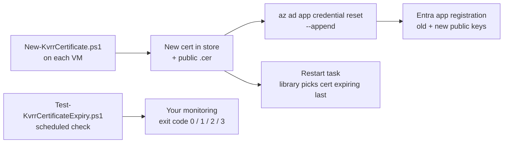

# HOWTO: Rotate the Service Principal Certificate and Monitor Its Expiry

## Overview and Purpose

A service principal that authenticates with a certificate from the Windows certificate store (see [Client-Certificate-Authentication-HOWTO.md](../Deployment/Client-Certificate-Authentication-HOWTO.md)) stops working on the day the certificate expires. This guide describes how to replace the certificate before that happens, without downtime, and how to be told in time if nobody did.

Two points shape everything below.

**The library gives no warning before expiry.** It emits no expiry log record and no metric for the client certificate. What the library does is check the certificate when the resolver is created: an expired certificate stops the application at setup with a specific message (see below). So expiry monitoring has to come from a check you run yourself. This guide provides one as a script, and you wire it into your own monitoring.

**Rotation is overlap, not replacement.** An Entra app registration can hold several certificates at once, and the library picks the certificate that is currently valid and expires last (when the options name only the client ID). So the safe order is: add the new certificate, switch over, and only then remove the old one. A thumbprint-pinned configuration is the exception and has to be updated by hand.

What the library does with a certificate that has expired, at the moment the resolver is created:

```text
The client certificate with thumbprint 4602142F... in the My certificate store of CurrentUser
(process user 'DOMAIN\svc-consumer') expired on 2026-11-10 19:49:48Z. Renew it and register
the new certificate with the service principal.
```

This is an `InvalidOperationException` thrown from `AddKeyVaultReferenceResolver`, before any vault call. The application does not start. That is deliberate, but it is still an outage, which is why the monitoring below exists.

## How It Fits Together



## Prerequisites

- The certificate and app registration from the client certificate HOWTO, with `$clientId` known.
- Azure CLI (`az`), logged in as someone allowed to update credentials on the app registration (the app's owner, or an administrator role). Do **not** give the VM's own service principal that permission just to automate this; see "Limitations".
- PowerShell 5.1 or 7. `New-SelfSignedCertificate` is part of the Windows PKI module.
- Access to each VM as the account that runs the application (or an elevated session for `LocalMachine`).

## Step 1: Choose the schedule

A certificate created with the default `-ValidityDays 365` should be replaced well before its end. A workable rhythm:

| Event | When |
| --- | --- |
| Create and register the new certificate | 60 days before the current one expires |
| Switch over (restart the task) | Within a few days after registering |
| Remove the old certificate | After the switch-over has been confirmed on every VM |

The warning threshold of the expiry check in Step 6 (30 days by default) should be *later* than the rotation date, so the check only fires when a rotation was missed.

## Step 2: Create the new certificate on the VM

Save this as `New-KvrrCertificate.ps1`. It creates a new non-exportable certificate named after the client ID, exports **only the public part**, and can optionally upload it and clean up expired certificates.

```powershell
[CmdletBinding()]
param(
    [Parameter(Mandatory)] [string] $ClientId,
    [ValidateSet('CurrentUser', 'LocalMachine')] [string] $StoreLocation = 'CurrentUser',
    [int] $ValidityDays = 365,
    [string] $OutDirectory = (Get-Location).Path,
    [switch] $Upload,
    [switch] $RemoveExpired
)

# Creates a new non-exportable certificate named after the client ID, exports its PUBLIC part,
# and optionally uploads it to the app registration (needs az, already logged in) and removes
# local certificates for this client ID that have already expired.
# Run it as the account whose store should hold the certificate (elevated for LocalMachine).

$ErrorActionPreference = 'Stop'
$store = "Cert:\$StoreLocation\My"

$cert = New-SelfSignedCertificate `
    -Subject "CN=$ClientId" `
    -CertStoreLocation $store `
    -KeyExportPolicy NonExportable `
    -KeyAlgorithm RSA -KeyLength 2048 `
    -HashAlgorithm SHA256 `
    -Provider 'Microsoft Software Key Storage Provider' `
    -NotAfter (Get-Date).AddDays($ValidityDays)

$cerPath = Join-Path $OutDirectory "$ClientId-$($cert.Thumbprint).cer"
Export-Certificate -Cert $cert -FilePath $cerPath -Type CERT | Out-Null
Write-Output "Created $($cert.Thumbprint), valid until $($cert.NotAfter.ToString('yyyy-MM-dd')). Public key: $cerPath"

if ($Upload) {
    az ad app credential reset --id $ClientId --cert "@$cerPath" --append | Out-Null
    if ($LASTEXITCODE -ne 0) { throw "az ad app credential reset failed ($LASTEXITCODE); the new certificate is in the store but not registered." }
    Write-Output "Registered the public key on app $ClientId (existing credentials kept)."
}
else {
    Write-Output "Not uploaded. Register it: az ad app credential reset --id $ClientId --cert `"@$cerPath`" --append"
}

if ($RemoveExpired) {
    $now = Get-Date
    Get-ChildItem $store |
        Where-Object {
            $_.Thumbprint -ne $cert.Thumbprint -and
            $_.NotAfter -lt $now -and
            $_.Subject.IndexOf($ClientId, [StringComparison]::OrdinalIgnoreCase) -ge 0
        } |
        ForEach-Object {
            Write-Output "Removing expired certificate $($_.Thumbprint) (expired $($_.NotAfter.ToString('yyyy-MM-dd')))"
            Remove-Item $_.PSPath -DeleteKey -Confirm:$false
        }
}
```

Run it on each VM, as the account the application runs as:

```powershell
.\New-KvrrCertificate.ps1 -ClientId $clientId -OutDirectory C:\Temp
```

Without `-Upload` it only creates the certificate and the `.cer`, and prints the `az` command to register it. That is the safer default: the VM never needs an Azure login, and you can collect the `.cer` files and register them from your own workstation. The `.cer` contains no private key and can be copied freely.

`-RemoveExpired` only removes certificates that are **already expired**; it never removes the certificate that is still in use. It removes the private key together with the certificate (`-DeleteKey`).

## Step 3: Register the public key

From a machine where `az` is signed in:

```powershell
az ad app credential reset --id $clientId --cert "@C:\Temp\<clientId>-<thumbprint>.cer" --append
```

`--append` is essential. Without it the command **replaces** every certificate on the app registration, and every other VM using it loses access at once.

Or let the script do it on a VM where `az` is signed in: add `-Upload`.

Repeat for each VM, because a non-exportable key cannot be copied: every VM has its own certificate and each one's public key has to be registered.

## Step 4: Switch over

Restart the task (or the application) on the VM. The expiry script from Step 6 reports the certificate the library will pick, so it shows the new end date as soon as the certificate is in the store; the application itself only switches on its next start.

| How the application names the certificate | What to do |
| --- | --- |
| `new CertificateStoreCredentialOptions(tenantId, clientId)` | Nothing. The valid certificate expiring last is picked. |
| With a thumbprint | Change the thumbprint in the application's configuration, then restart. |

A long-running process keeps the certificate it loaded at start. Only a restart switches it.

## Step 5: Remove the old certificate

Only after every VM has switched and a vault read has succeeded with the new certificate.

On each VM, after the old certificate has expired, `-RemoveExpired` from Step 2 does this on the next rotation. To remove it earlier:

```powershell
Remove-Item "Cert:\CurrentUser\My\<old thumbprint>" -DeleteKey
```

In Entra ID, remove the expired credentials from the app registration. First list them and check the field names that your Azure CLI version returns:

```powershell
az ad app credential list --id $clientId
```

Then delete the ones that have expired:

```powershell
$credentials = az ad app credential list --id $clientId | ConvertFrom-Json
$credentials |
    Where-Object { [datetime]$_.endDateTime -lt (Get-Date) } |
    ForEach-Object { az ad app credential delete --id $clientId --key-id $_.keyId }
```

Expired credentials are harmless to leave in place, so this is housekeeping rather than urgent. Never delete a credential whose certificate is still in use somewhere.

## Step 6: Monitor expiry

Save this as `Test-KvrrCertificateExpiry.ps1`. It finds the certificate the library would pick and reports how long it has left. The exit code is meant for a scheduler or monitoring agent.

```powershell
[CmdletBinding()]
param(
    [Parameter(Mandatory)] [string] $ClientId,
    [int] $WarnDays = 30,
    [int] $CriticalDays = 7,
    [ValidateSet('CurrentUser', 'LocalMachine')] [string[]] $StoreLocation = @('CurrentUser', 'LocalMachine')
)

# Exit codes: 0 = OK, 1 = warning, 2 = critical (expiring soon, expired or unusable), 3 = no certificate found.
# Reports on the certificate the library would pick: a valid one with a private key first, then the one expiring last.

$now = Get-Date
$skew = [TimeSpan]::FromMinutes(5)

$candidates = foreach ($location in $StoreLocation) {
    Get-ChildItem "Cert:\$location\My" -ErrorAction SilentlyContinue |
        Where-Object {
            $_.Subject.IndexOf($ClientId, [StringComparison]::OrdinalIgnoreCase) -ge 0 -or
            $_.FriendlyName.IndexOf($ClientId, [StringComparison]::OrdinalIgnoreCase) -ge 0
        } |
        ForEach-Object {
            [pscustomobject]@{
                Location   = $location
                Thumbprint = $_.Thumbprint
                NotBefore  = $_.NotBefore
                NotAfter   = $_.NotAfter
                HasKey     = $_.HasPrivateKey
                Usable     = ($_.HasPrivateKey -and ($_.NotBefore -le $now + $skew) -and ($_.NotAfter -gt $now))
            }
        }
}

if (-not $candidates) {
    Write-Output "UNKNOWN: no certificate naming client ID $ClientId in $($StoreLocation -join ', ')"
    exit 3
}

$best = $candidates | Sort-Object @{ Expression = 'Usable'; Descending = $true }, @{ Expression = 'NotAfter'; Descending = $true } | Select-Object -First 1
$summary = "$($best.Location)\My $($best.Thumbprint), valid until $($best.NotAfter.ToString('yyyy-MM-dd'))"

if (-not $best.Usable) {
    Write-Output "CRITICAL: $summary, but not usable (HasPrivateKey=$($best.HasKey), NotBefore=$($best.NotBefore.ToString('yyyy-MM-dd')), expired=$($best.NotAfter -le $now))"
    exit 2
}

$daysLeft = [int][math]::Floor(($best.NotAfter - $now).TotalDays)
if ($daysLeft -le $CriticalDays) { Write-Output "CRITICAL: $summary ($daysLeft days left)"; exit 2 }
if ($daysLeft -le $WarnDays)     { Write-Output "WARNING: $summary ($daysLeft days left)";  exit 1 }
Write-Output "OK: $summary ($daysLeft days left)"
exit 0
```

Example output:

```text
OK: CurrentUser\My 4602142F93D5F944DFE16F30A9DBEBDE8EC19DA0, valid until 2027-11-12 (364 days left)
```

| Exit code | Meaning | Typical monitor state |
| --- | --- | --- |
| 0 | Valid, more than `WarnDays` left | OK |
| 1 | Valid, `WarnDays` or fewer left | Warning |
| 2 | `CriticalDays` or fewer left, expired, no private key, or not yet valid | Critical |
| 3 | No certificate names the client ID in the searched stores | Unknown |

Because it reports the certificate the library would choose, an old certificate that is about to expire is correctly ignored once a newer valid one exists.

Run it **as the account that owns the store**. For `CurrentUser` a different account sees a different store, and the script would report exit code 3.

To run it daily as a scheduled task under the same account as the application:

```powershell
$cred    = Get-Credential "DOMAIN\svc-consumer"
$action  = New-ScheduledTaskAction -Execute "pwsh.exe" `
    -Argument "-NoProfile -File C:\Ops\Test-KvrrCertificateExpiry.ps1 -ClientId $clientId"
$trigger = New-ScheduledTaskTrigger -Daily -At 6am
Register-ScheduledTask -TaskName "KvrrCertExpiryCheck" -Action $action -Trigger $trigger `
    -User $cred.UserName -Password $cred.GetNetworkCredential().Password
```

The scheduler records the exit code as `LastTaskResult` (`Get-ScheduledTaskInfo -TaskName KvrrCertExpiryCheck`). A monitoring agent can read that, or run the script directly and map the exit code and the first output line to its own states. Use `powershell.exe` instead of `pwsh.exe` if PowerShell 7 is not installed.

## Troubleshooting

| Symptom | Cause | Fix |
| --- | --- | --- |
| `New-SelfSignedCertificate` fails with `NTE_PROV_TYPE_NOT_DEF` (0x80090017) | A `-KeySpec` was added together with the Key Storage Provider. | Remove `-KeySpec`. The script above does not set it. |
| Other VMs lose access right after a rotation | `az ad app credential reset` was run without `--append`, which replaced all certificates. | Re-register each VM's `.cer` with `--append`. |
| Application fails at setup with `...expired on <date>` | Rotation was missed. | Run Step 2 and Step 3, restart. The message is the library's specific expiry failure. |
| After rotation the application still reports the old certificate | The task was not restarted, or the explicit form pins the old thumbprint. | Restart; update the thumbprint if pinned. |
| Expiry script exits 3 although the certificate exists | Wrong account: the certificate is in another account's `CurrentUser` store. | Run the script as the application's account, or use `LocalMachine`. |
| Expiry script exits 2 with `not usable` and `HasPrivateKey=False` | A public-only copy matches the client ID, and no usable certificate does. | Create the certificate on this VM (Step 2). |
| `az ad app credential reset` reports insufficient privileges | The signed-in identity cannot modify the app registration. | Sign in as the app's owner or an administrator. |
| A removed certificate still shows up | `Remove-Item` was run without `-DeleteKey`, or against the wrong store location. | Check `Cert:\CurrentUser\My` and `Cert:\LocalMachine\My`. |

## Security Considerations

- **Only public keys leave the VM.** The `.cer` is not secret. The private key stays in the store and is non-exportable.
- **Keep the VM out of the rotation permission.** Whoever can add a credential to the app registration can authenticate as the service principal. Prefer rotating from an administrator's session or a pipeline over granting each VM that right.
- **Do not widen validity to avoid rotation.** A shorter lifetime limits what a stolen disk image plus a compromised account is worth.
- **Clean up old private keys.** `Remove-Item ... -DeleteKey` removes the key as well, which a plain certificate removal does not guarantee.
- **The monitoring output names no secret.** It contains the thumbprint, store and dates only.

## Limitations

- The library does not monitor or report certificate expiry. The script in this guide is operational tooling, not a feature of the package, and it is only as reliable as the scheduler that runs it.
- Unattended self-rotation by the VM needs an identity that is allowed to add credentials to the app registration (owner plus a suitable Microsoft Graph application permission). That is a privilege decision, not something the library or this guide grants.
- The scripts target the `My` store, as the library does, and assume Windows.
- Output field names of `az ad app credential list` differ between Azure CLI versions. Check them before scripting deletion, as noted in Step 5.

## Related Documents

- [Client-Certificate-Authentication-HOWTO.md](../Deployment/Client-Certificate-Authentication-HOWTO.md): initial setup
- [Scheduled-Task-Deployment-HOWTO.md](../Deployment/Scheduled-Task-Deployment-HOWTO.md): running the consumer as a task
- [Diagnose-Authentication-Failures-HOWTO.md](Diagnose-Authentication-Failures-HOWTO.md): when authentication fails anyway
- [Logging-And-Monitoring.md](Logging-And-Monitoring.md): event IDs
- [Vault-Authentication-Methods.md](../Features/Vault-Authentication-Methods.md): how the credential is chosen
