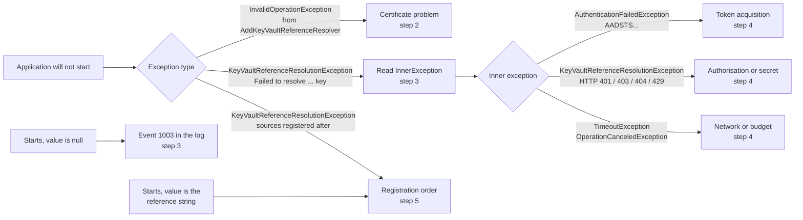

# HOWTO: Diagnose Authentication Failures

## Overview and Purpose

When the application cannot read its secrets, the cause sits in one of three places, and the fastest way to a fix is to find out which one before changing anything:

1. **Credential selection.** Which identity did the library decide to use? A stray environment variable or a leftover option can pick a different identity than the one you configured.
2. **Token acquisition.** Can that identity obtain a token from Entra ID? Certificate, tenant, client ID and clock problems fail here, with an `AADSTS` code.
3. **Authorisation.** Does Key Vault let that identity read the secret? Role, access policy and firewall problems fail here, with an HTTP status.

This guide gives a path from the symptom to the layer, and then to the fix. It is about the Azure Key Vault side. For the HashiCorp package see [Vault-Authentication-Methods.md](../Features/Vault-Authentication-Methods.md) and the HashiCorp section of the [Troubleshooting-Guide.md](Troubleshooting-Guide.md). The message catalogue for everything that is not authentication is in the Troubleshooting Guide too; this guide complements it with the credential order and the certificate paths.

## How It Fits Together



## Prerequisites

- The application passes an `ILogger` to `AddKeyVaultReferenceResolver`. Without one the library logs to nothing and most of this guide has no input.
- Access to the VM or host as the account the application runs as. Most causes are only visible from that account.

## Step 1: See the whole exception

At startup the library wraps every vault failure, whatever its type, in a `KeyVaultReferenceResolutionException` whose message is only `Failed to resolve Key Vault reference for configuration key '<key>'`. The cause is in the **inner exceptions**. Log or print the whole chain:

```csharp
catch (Exception ex)
{
    for (Exception? e = ex; e != null; e = e.InnerException)
        logger.LogError("{Type}: {Message}", e.GetType().Name, e.Message);
    throw;
}
```

Example, an invalid certificate signature:

```text
KeyVaultReferenceResolutionException: Failed to resolve Key Vault reference for configuration key 'Db'
AuthenticationFailedException: ClientCertificateCredential authentication failed: AADSTS700027: Client assertion contains an invalid signature.
```

The library also logs the exception, with its chain, as event **1003** (`ResolutionFailed`, Error) naming the configuration key. When `ThrowOnResolveFailure` is `false` that record is the only signal, because the application starts with the key set to `null`.

Certificate checks are different: they run first, when the resolver is created, and throw an `InvalidOperationException` **unwrapped** (step 2).

## Step 2: Which credential is being used?

The library chooses the credential in a fixed order. The first one that applies wins, and the rest are never consulted:

| # | Credential | Applies when | How to tell |
| --- | --- | --- | --- |
| 1 | `options.Credential` | It is set in code. | Look for `Credential =` in the application's setup. |
| 2 | `options.ClientCertificate` | It is set in code and `Credential` is not. | Look for `ClientCertificate =`. Certificate failures are thrown at startup. |
| 3 | Environment convention | `AZURE_TENANT_ID` and `AZURE_CLIENT_ID` are set, a store certificate's subject or friendly name contains the client ID, none of `AZURE_CLIENT_SECRET`, `AZURE_CLIENT_CERTIFICATE_PATH`, `AZURE_FEDERATED_TOKEN_FILE`, `AZURE_USERNAME`, `AZURE_PASSWORD` is set, `ManagedIdentityClientId` is unset, `TenantId` is unset or equals `AZURE_TENANT_ID`, and `ExcludeEnvironmentCredential` is not `true`. | Log event **1007** (Information): "Authenticating with a store client certificate found for AZURE_CLIENT_ID". |
| 4 | `DefaultAzureCredential` | None of the above applies. | Environment credential, then workload identity, then managed identity, plus (only with `AllowDeveloperCredentials = true`) Azure CLI, Azure Developer CLI, Visual Studio and Azure PowerShell. Interactive browser is always excluded. |

Two consequences:

- **No event 1007 does not mean the certificate is broken.** It means rows 1 to 3 did not apply and the default chain ran. If you expected the convention, check each condition in row 3. In particular, the convention silently does nothing when no certificate matches, or when the store cannot be opened.
- **The library does not log which credential of the default chain succeeded.** Enable Azure SDK logging (`AzureEventSourceListener`) to see it, and be aware that these logs include request URIs, which contain secret names. See the `ClientOptions` remarks in [Configuration-Reference.md](../Deployment/Configuration-Reference.md).

When an option appears to have no effect, check row 1 first: `options.Credential` silently makes `ManagedIdentityClientId`, `TenantId`, `AllowDeveloperCredentials` and `ExcludeEnvironmentCredential` inert.

### Certificate messages at startup

These are `InvalidOperationException`s from `AddKeyVaultReferenceResolver`, thrown before any vault call:

| Message starts with | Cause | Fix |
| --- | --- | --- |
| `No client certificate whose subject or friendly name contains the client ID <id> was found in the My certificate store of <locations> (process user '<user>')` | Explicit `ClientCertificate` without a thumbprint, and no match. | Check the subject, and that you run as the account whose store holds it. |
| `The client certificate with thumbprint <t> was not found in the My certificate store of <location> (process user '<user>')` | Explicit thumbprint not in that store. | Wrong thumbprint, wrong account, or wrong store location. |
| `The client certificate with thumbprint <t> could not be found: the My certificate store of <location> ... could not be opened` | The store could not be opened (typically a platform without the store, or a missing store). | Run on Windows as the right account; check the store exists. |
| `... has no private key, or this account cannot access it` | Certificate without key, or key without Read for this account. | Create the certificate on this VM; for the machine store grant the account Read on the key. |
| `... expired on <date>` | Past its end date. | Rotate. See [Certificate-Rotation-And-Expiry-Monitoring-HOWTO.md](Certificate-Rotation-And-Expiry-Monitoring-HOWTO.md). |
| `... is not valid before <date>` | Start date in the future or a wrong clock (5 minutes of skew are tolerated). | Check the machine clock and the certificate's start date. |

Every message names the thumbprint, the store and the process user. The process user is the account that matters: compare it with the account you expected.

## Step 3: Read the inner exception

| Inner exception | Layer | Meaning |
| --- | --- | --- |
| `AuthenticationFailedException` with an `AADSTS` code, or "... failed to retrieve a token from the included credentials" | Token acquisition | No token could be obtained. Step 4. |
| `KeyVaultReferenceResolutionException`: `Access denied reading <uri> (HTTP 403)` (also HTTP 401) | Authorisation | Authentication worked or was challenged; the vault refused. Step 4. |
| `KeyVaultReferenceResolutionException`: `Secret not found at <uri> (HTTP 404)` | Secret | Name, case or soft-deletion. The identity works. |
| `KeyVaultReferenceResolutionException`: `Key Vault throttled the request ... (HTTP 429)` | Vault | Reduce `MaxConcurrency`, or stagger starts. |
| `KeyVaultReferenceResolutionException`: `Failed to read <uri> from Key Vault (HTTP <n>)` | Vault | Any other status. |
| `TimeoutException`: `Timeout resolving secret from <uri>` | Network | One secret exceeded `Timeout` (default 30 seconds). Token acquisition counts inside it. |
| `TaskCanceledException` (`OperationCanceledException`): `A task was canceled.` | Budget | The `OverallTimeout` (default 2 minutes) ran out for all references together. |
| `ArgumentException`: `Vault host '<host>' is not an allowed Key Vault host`, `... is not listed in ...AllowedVaultHosts`, `Key Vault secret URIs must use https`, `Invalid Key Vault secret URI format` | Reference | The reference is rejected before any request. Not an authentication problem. |
| `KeyVaultReferenceResolutionException`: `Secret <uri> expired at <date>` / `is not valid until <date>` | Secret | Only when `RejectSecretsOutsideValidityPeriod` is `true`. |

The secret name in `<uri>` is masked as `***` in these messages; the vault host stays.

## Step 4: From the symptom to the fix

### AADSTS codes (token acquisition)

These come from Entra ID. They are Microsoft's codes, not the library's; the library passes them through in the inner exception message.

| Code | Meaning | Fix |
| --- | --- | --- |
| `AADSTS700027` | Client assertion contains an invalid signature. The certificate in the store is not one registered on the app. | Register the current certificate's public key (`az ad app credential reset --append`), and check the thumbprint in the portal. |
| `AADSTS700016` | Application not found in the tenant. | Wrong `AZURE_CLIENT_ID` or `AZURE_TENANT_ID`, or the app lives in another tenant. |
| `AADSTS700024` | Client assertion is not within its valid time range. | The machine clock is wrong. Fix time synchronisation. |
| `AADSTS90002` | Tenant not found. | Wrong tenant ID or wrong authority host (sovereign clouds need `AuthorityHost`). |
| `AADSTS7000215` | Invalid client secret. | A stray `AZURE_CLIENT_SECRET` is selecting the environment credential. Remove it; it also switches the certificate convention off. |
| `AADSTS7000222` | Client secret expired. | Same: remove the stray secret and use the certificate. |

### HTTP status (authorisation)

| Status | Likely cause | Fix |
| --- | --- | --- |
| 401 | The token was not accepted (wrong audience, wrong tenant, sovereign cloud without `AuthorityHost`). | Check tenant and authority host. |
| 403 | The identity lacks `Key Vault Secrets User` (or `Get` in a legacy access policy), or the vault firewall blocks this caller. **Or the wrong identity was used.** | First confirm the identity (step 2), then the role on the vault, then the vault's network settings. |
| 404 | Wrong secret name or case, or a soft-deleted secret. | Fix the reference. |
| 429 | Throttled. | Lower `MaxConcurrency`; raise `Timeout` so the SDK's backoff can finish. |

The most common cause of a 403 is the wrong identity, not a missing role. When a role assignment looks right and the vault still refuses, go back to step 2.

### Timeouts

An unreachable Entra ID or vault ends as a `TimeoutException` (per secret) or a `TaskCanceledException` (overall budget). Check outbound access from the VM to `login.microsoftonline.com` and the vault host, proxy settings, and the vault firewall. A long start with a successful result points at a slow network rather than an authentication fault.

## Step 5: Silent cases

**The value is `null`.** Resolution ran and failed. Find event 1003 and follow step 3 for the cause. Event 1004 (`Resolved N of M ...`) with `N < M` is the aggregate.

**The value is the literal `@Microsoft.KeyVault(...)` string.** Resolution never saw it. Either a source was registered after the resolver, or the platform handles references itself. A source registered after the resolver that still carries a reference fails the build with a `KeyVaultReferenceResolutionException`: `Configuration source(s) registered after AddKeyVaultReferenceResolver carry unresolved reference(s) for: <keys>`, and events 1005 and 1006 are logged. Register the resolver last.

### Events worth searching for

| ID | Name | Level | Use |
| --- | --- | --- | --- |
| 1002 | `SecretRead` | Information | A vault read succeeded; authentication and authorisation worked. |
| 1003 | `ResolutionFailed` | Error | A reference failed. Carries the key and the exception chain. |
| 1004 | `ResolutionSummary` | Information | `Resolved {Count} of {Total}`. |
| 1005 | `ResolverNotLastSource` | Error | Sources were registered after the resolver and could not be inspected. |
| 1006 | `UnresolvedReference` | Error | A key still holds a reference. |
| 1007 | `ClientCertificateFromEnvironment` | Information | The environment convention selected a store certificate. |
| 1001 | `SecretResolved` | Debug | Names the secret. Local diagnosis only. |

## Step 6: Confirm from the machine

Run these as the account the application runs as.

```powershell
# What the process will see
[Environment]::GetEnvironmentVariable("AZURE_TENANT_ID",  "User")
[Environment]::GetEnvironmentVariable("AZURE_CLIENT_ID",  "User")
[Environment]::GetEnvironmentVariable("AZURE_CLIENT_SECRET", "User")      # should be empty
[Environment]::GetEnvironmentVariable("AZURE_CLIENT_ID",  "Machine")      # Machine scope too

# The certificate the convention would find
Get-ChildItem Cert:\CurrentUser\My, Cert:\LocalMachine\My |
    Where-Object { $_.Subject -like "*$env:AZURE_CLIENT_ID*" } |
    Select-Object PSParentPath, Subject, Thumbprint, NotBefore, NotAfter, HasPrivateKey

# The clock
w32tm /query /status
```

Also check the vault side with the portal or `az keyvault` as an administrator: the role assignment of the application's client ID, the vault firewall, and the vault's diagnostic log. A read that appears in the vault's own log reached the vault; one that does not never got there.

You cannot reproduce the call with `az login --service-principal --certificate` for a non-exportable certificate: that command needs a PEM file containing the private key, which such a certificate cannot provide. The application itself, with logging on, is the reproduction.

## Troubleshooting This Guide

| Symptom | Cause | Fix |
| --- | --- | --- |
| No event 1007, but a certificate exists | The conditions in row 3 of step 2 are not all met, or the store cannot be read by this account. | Run the certificate query in step 6 as the application's account; check for `AZURE_CLIENT_SECRET`. |
| The inner exception is missing from the log | The logger records only `ex.Message`. | Log the whole chain as in step 1, or use a provider that formats exceptions. |
| Messages show `***` instead of a secret name | By design: names are masked in exceptions. | Enable Debug logging locally (event 1001) to see names. |
| The error changes between runs | Several credentials in the default chain are in play, or the environment differs between interactive and task runs. | Compare the environment of the task's account (step 6). |

## Security Considerations

- **Do not enable Debug logging in production.** Event 1001 names secrets.
- **Azure SDK logging includes request URIs**, and therefore secret names. Filter the `Azure-Core` event source if names are sensitive.
- **Error messages contain the process user and certificate thumbprint**, never key material. Treat logs as internal but they are not secret.
- **Do not work around a failure by adding a secret** such as `AZURE_CLIENT_SECRET` to the environment. It switches the certificate convention off and puts a secret back where this setup avoids one.

## Limitations

- The library does not report which credential of the default chain succeeded. Use Azure SDK logging for that.
- The library emits no certificate-expiry signal. See the rotation HOWTO for a check you run yourself.
- The `AADSTS` codes are Microsoft's and can change or gain new meanings. Look a code up in Microsoft's documentation when it is not listed here.
- This guide covers the Azure package. The HashiCorp package has its own credential order and events (2000 range).

## Related Documents

- [Troubleshooting-Guide.md](Troubleshooting-Guide.md): the complete message catalogue
- [Logging-And-Monitoring.md](Logging-And-Monitoring.md): event IDs and logging setup
- [Client-Certificate-Authentication-HOWTO.md](../Deployment/Client-Certificate-Authentication-HOWTO.md): the certificate setup
- [Scheduled-Task-Deployment-HOWTO.md](../Deployment/Scheduled-Task-Deployment-HOWTO.md): running the consumer as a task
- [Certificate-Rotation-And-Expiry-Monitoring-HOWTO.md](Certificate-Rotation-And-Expiry-Monitoring-HOWTO.md): replacing an expiring certificate
- [Vault-Authentication-Methods.md](../Features/Vault-Authentication-Methods.md): how the credential is chosen
