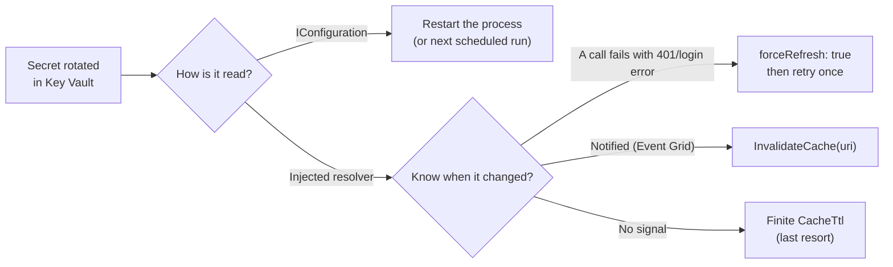

# HOWTO: Pick Up a Rotated Key Vault Secret

## Overview and Purpose

A secret was rotated in Key Vault. This guide shows how a running application gets the new value, and which secrets can be refreshed in place at all.

The answer depends on **how the application reads the secret**, because there are two places a resolved value can live:

| Where the application reads it | Picks up a rotation | How |
| --- | --- | --- |
| `IConfiguration` (`config["Db:Password"]`, bound options) | Only after a restart | Values are resolved once, while the configuration is built |
| An injected `KeyVaultSecretResolver` | On demand, without a restart | `forceRefresh: true`, `InvalidateCache`, or a finite `CacheTtl` |

There is no `IChangeToken`, no `IOptionsMonitor` integration and no background timer in the library. The resolved configuration provider has no reload path: nothing in the library can change a value in `IConfiguration` after startup. Everything is either fixed at startup or pulled on demand.

The library deliberately does not poll. Secrets rotate rarely, so a timer mostly buys vault traffic and throttling risk, and still notices a rotation late. The recommended pattern is to **refresh on evidence**: when a downstream call fails with an authentication error, re-read the secret once and retry. The background and rationale are in [Secret-Caching-And-Rotation.md](../Features/Secret-Caching-And-Rotation.md); this guide is the practical recipe.

## Which Pattern Fits



For a console exe run as a Scheduled Task, nothing persists between runs, so every run resolves the current value and rotation needs no action at all. The patterns below matter for long-running processes.

## Prerequisites

- A long-running application that can take a dependency on `KeyVaultSecretResolver` (the concrete type; `forceRefresh` is not on `ISecretResolver`).
- The secret's reference or URI available to the code that needs it (see Step 2).

## Step 1: Decide which secrets must rotate in place

Most secrets are fine in `IConfiguration` and a rolling restart. Move a secret to direct resolver access only if the application cannot restart when it rotates, such as an API key held by a process that runs for weeks.

Keep both worlds deliberately separate: references in configuration for things stable for a deployment's lifetime, resolver calls for things that may change under a running process.

## Step 2: Register one resolver in dependency injection

`AddKeyVaultReferenceResolver()` creates its own resolver internally and does not expose it, so there is no handle to refresh. Register a separate singleton:

```csharp
var builder = WebApplication.CreateBuilder(args);

// Startup references: frozen into IConfiguration.
builder.Configuration.AddKeyVaultReferenceResolver();

// Runtime, refreshable access: a separate, DI-managed instance.
builder.Services.AddSingleton<KeyVaultSecretResolver>(sp =>
    new KeyVaultSecretResolver(
        new KeyVaultReferenceResolverOptions(),
        sp.GetRequiredService<ILogger<KeyVaultSecretResolver>>()));
builder.Services.AddSingleton<ISecretResolver>(sp => sp.GetRequiredService<KeyVaultSecretResolver>());
```

Register it as a singleton: the resolver's value is the client and secret caches it holds, and the container disposes it at shutdown. This instance has its own cache and its own credential; it shares nothing with the instance used at startup. Use the same credential options as the startup call (for example `ManagedIdentityClientId`, or `ClientCertificate`).

## Step 3: Resolve at the point of use, by URI

`ResolveSecretAsync` takes the **secret URI**, not the `@Microsoft.KeyVault(...)` reference string. Passing the reference string throws an `ArgumentException`.

Do not put a reference in configuration for a secret you will read at runtime: the startup pass would resolve it into `IConfiguration`, and you would be holding the value, not the reference. Keep the plain URI instead. It is not a reference, so the startup pass leaves it untouched:

```json
{
  "Secrets": {
    "ApiKeyUri": "https://contoso-prod.vault.azure.net/secrets/api-key"
  }
}
```

If you need to derive the URI from a reference string you already hold, `KeyVaultReferenceResolverExtensions.ExtractSecretUri(reference)` returns it for either reference format. It composes a `VaultName` reference against the public-cloud suffix `vault.azure.net`, so in a sovereign cloud use the `SecretUri` form or the plain URI.

## Step 4: Refresh on evidence

```csharp
public sealed class DownstreamClient
{
    private readonly KeyVaultSecretResolver _resolver;
    private readonly string _apiKeyUri;
    private readonly Func<string, CancellationToken, Task<HttpStatusCode>> _send;

    public DownstreamClient(
        KeyVaultSecretResolver resolver,
        IConfiguration configuration,
        Func<string, CancellationToken, Task<HttpStatusCode>> send)
    {
        _resolver = resolver;
        _apiKeyUri = configuration["Secrets:ApiKeyUri"]
            ?? throw new InvalidOperationException("Secrets:ApiKeyUri is not configured.");
        _send = send;
    }

    public async Task<HttpStatusCode> CallAsync(CancellationToken ct)
    {
        var key = await _resolver.ResolveSecretAsync(_apiKeyUri, ct);
        var status = await _send(key, ct);

        if (status == HttpStatusCode.Unauthorized)
        {
            // The cached key may have been rotated. Re-read once and retry.
            var fresh = await _resolver.ResolveSecretAsync(_apiKeyUri, forceRefresh: true, ct);
            if (fresh != key)
                status = await _send(fresh, ct);
        }

        return status;
    }
}
```

The `fresh != key` guard avoids a pointless second call when the vault still holds the same value, which means the rejection has another cause. `forceRefresh: true` bypasses the cache, reads the vault and replaces the cache entry in one call, which is better than `InvalidateCache` followed by a resolve because another thread cannot repopulate the entry in between.

Retry once, not in a loop. A secret that is still rejected after a fresh read is not a rotation problem.

## Step 5: Optional signals and settings

**Push instead of pull.** Key Vault can publish a `SecretNewVersionCreated` event through Event Grid. The library does not subscribe to it, but a handler in your application can call `InvalidateCache(uri)` so the next resolve goes back to the vault. This requires the application to be reachable by the notification. Verify the event type and subscription setup against the Azure Key Vault Event Grid documentation for your environment.

**Evict by URI.** `InvalidateCache(uri)` removes one entry; `InvalidateCache()` clears all, so every secret is re-read on its next use. Prefer the single-key form. Both only affect this instance and never `IConfiguration`.

**Finite `CacheTtl`.** The default is `Timeout.InfiniteTimeSpan`: cached for the life of the resolver. A finite value makes entries re-read after they expire:

```csharp
new KeyVaultReferenceResolverOptions { CacheTtl = TimeSpan.FromHours(6) }
```

Use it only if you want time-based expiry as well. The cost is reads that almost always confirm nothing changed, and 429 throttling when a fleet of instances expires in lockstep. It still does not detect a rotation promptly: the old value is used until the entry expires. Zero or negative values are rejected; to cache nothing use `EnableCaching = false`, which suits a resolver used only at startup, and not one injected into request handling.

**Cache size.** `MaxCacheEntries` defaults to 1024 (`0` is unlimited). When it is reached, further secrets are no longer cached (they are read from the vault every time), entries already cached are kept, and warning 1202 is logged once. This matters only if you resolve URIs chosen at runtime.

**Pinned versions do not rotate.** A URI with a version segment (`.../secrets/api-key/<version>`) always reads that exact version, whatever is current. To follow rotation, use the URI without a version.

## Step 6: Surface expiry before it hurts

Rotation goes better when expiry is visible. Every time a secret is read from the vault (not on cache hits), the library compares the secret's `NotBefore` and `ExpiresOn` with the clock:

| Event | Name | Fires when |
| --- | --- | --- |
| 1101 | `SecretExpired` | `ExpiresOn` has passed and `RejectSecretsOutsideValidityPeriod` is off |
| 1102 | `SecretExpiringSoon` | Expiry is within `ExpiryWarningThreshold` (default 7 days; `TimeSpan.Zero` disables it) |
| 1103 | `SecretNotYetValid` | `NotBefore` is in the future and rejection is off |

All three are warnings that name the vault, not the secret. Route 1102 to a ticketing system rather than an alert channel. Adopt rejection in stages, as described in [Secret-Validity-Enforcement.md](../Features/Secret-Validity-Enforcement.md): observe with the defaults, widen `ExpiryWarningThreshold` while remediating, and set `RejectSecretsOutsideValidityPeriod = true` only once no 1101 has appeared for a full rotation cycle. Turning it on while expiry dates are stale stops applications that are using perfectly valid secrets.

Because the check runs when the vault is read, an application with the default infinite TTL reports 1101 to 1103 at startup and on each refresh, not on every use.

## Step 7: Verify that rotation works

In a non-production environment:

1. Start the application and let it read the secret once.
2. Create a new version of the secret in the vault (portal, or `az keyvault secret set --vault-name <vault> --name <secret> --value <new value>`).
3. Trigger the refresh path (cause the downstream 401, call `InvalidateCache(uri)`, or let the TTL elapse).
4. Check the logs: a new `SecretRead` (1002, Information, names the vault) appears for that read. At Debug level, a `CacheHit` (1201) appearing instead means the cache served the old value.

## Troubleshooting

| Symptom | Cause | Fix |
| --- | --- | --- |
| The application still uses the old secret after rotation, and it reads `config["..."]` | Configuration values are resolved once at startup | Restart, or move the secret to direct resolver access (Steps 2 to 4) |
| `InvalidateCache` or `forceRefresh` has no effect on a value read from `IConfiguration` | They only touch the resolver cache | Same as above: `IConfiguration` cannot be refreshed |
| `ArgumentException: Invalid Key Vault secret URI` | A `@Microsoft.KeyVault(...)` reference string was passed to `ResolveSecretAsync` | Pass the URI (Step 3) |
| Refreshing the resolver you registered does not change the startup configuration | Two instances: the startup one is internal and has its own cache | Expected. Read the secret through the registered resolver |
| The new version is never used | The URI pins a version | Use the URI without a version segment |
| A refresh throws, and the old value keeps being served | With `RejectSecretsOutsideValidityPeriod` on, a read that is rejected is not cached, and the previous cache entry stays in place | Fix the secret's expiry or validity dates in the vault, then refresh again |
| HTTP 429 from Key Vault | A finite `CacheTtl` across many instances, or `EnableCaching = false` on a hot path | Raise the TTL or re-enable caching; refresh on evidence instead |
| Warning 1202 (`CacheFull`) and a vault read on every call | More distinct URIs than `MaxCacheEntries` | Raise the limit, or `0` for unlimited, if the set is bounded |
| 1101 `SecretExpired` at startup | The secret's `ExpiresOn` has passed and rejection is off, so it is used anyway | Rotate it, or correct the expiry metadata |

## Security Considerations

- **A refresh keeps the old value on failure.** A failed or rejected refresh throws and leaves the previous cache entry in place, so a bad rotation does not wipe a working credential. It also means a revoked old secret may keep being served by the cache until a refresh succeeds. Pair revocation with a refresh or restart.
- **Secrets stay in memory.** Resolved values are managed strings and cannot be zeroed. `Dispose` drops the references so the garbage collector can reclaim them, which is a mitigation, not a guarantee. Values already in `IConfiguration` stay reachable.
- **Do not log the URI at Information.** The library keeps secret names out of its own Information-level records, because the set of names amounts to an inventory of the vault. Do the same in your retry code.

## Limitations

- `IConfiguration` and anything bound from it (`IOptions<T>`, `IOptionsMonitor<T>`) cannot be refreshed; options bound from resolved configuration are bound once.
- `forceRefresh` is on the concrete `KeyVaultSecretResolver`, not on `ISecretResolver`. Inject the concrete type, or wrap it in a small interface of your own.
- Concurrent resolution of one URI may fetch twice (no per-key locking). This is a duplicated read, not a correctness problem.
- The HashiCorp resolver has the same cache model. It keys entries by the raw reference string, so `InvalidateCache` must be called with the exact string that was resolved; see [Secret-Caching-And-Rotation.md](../Features/Secret-Caching-And-Rotation.md).

## Related Documents

- [Secret-Caching-And-Rotation.md](../Features/Secret-Caching-And-Rotation.md): the two caches and why there is no polling
- [Secret-Validity-Enforcement.md](../Features/Secret-Validity-Enforcement.md): events 1101 to 1103 and the staged adoption path
- [Logging-And-Monitoring.md](Logging-And-Monitoring.md): event IDs for alerts
- [Configuration-Reference.md](../Deployment/Configuration-Reference.md): `EnableCaching`, `CacheTtl`, `MaxCacheEntries` and the other options
- [Unit-Testing-With-ISecretResolver-HOWTO.md](../Development/Unit-Testing-With-ISecretResolver-HOWTO.md): testing code that resolves secrets
