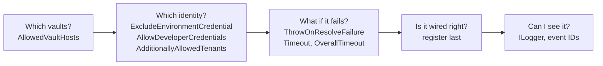

# HOWTO: Production Hardening Checklist

## Overview and Purpose

This checklist lists the settings to review before an application that uses KeyVaultReferenceResolver goes into production. Each item gives the exact option, its default, and the reason in one or two lines. It does not restate the threat model; for the reasoning behind each control see [Security-Model.md](../Architecture/Security-Model.md).

The defaults are already conservative in most places (fail-closed resolution, developer credentials off, host suffix allow list, content logging off). Three settings are *not* safe by default and are the ones that matter most: `AllowedVaultHosts` is empty, `ExcludeEnvironmentCredential` is `false`, and nothing registers the resolver last for you.

## How to use this checklist

Work top to bottom; items are ordered by the risk they remove. Each has a **Set** line (what to configure), a **Default** line, and a **Why** line. A combined example is at the end.



## The checklist

### 1. Pin resolution to your own vaults

- **Set:** `options.AllowedVaultHosts = new List<string> { "contoso-prod.vault.azure.net" };`
- **Default:** empty, which leaves `AllowedVaultHostSuffixes` in charge.
- **Why:** the suffix list only proves a host *is a Key Vault*, not whose. `https://someone-elses.vault.azure.net` satisfies the default suffixes, and contacting it presents this application's token to a vault under someone else's control. When `AllowedVaultHosts` is populated it is authoritative and the suffix list is not consulted. Entries are compared against the whole host, case-insensitively.
- **Also:** do not clear `AllowedVaultHostSuffixes` to "make it work". Add the missing suffix instead (private DNS names, sovereign clouds). An empty suffix list disables the check.

### 2. Take the identity from the platform, not the environment

- **Set:** `options.ExcludeEnvironmentCredential = true;` on every managed-identity and workload-identity host.
- **Default:** `false` (backwards compatibility).
- **Why:** the environment credential (`AZURE_CLIENT_ID` / `AZURE_TENANT_ID` / `AZURE_CLIENT_SECRET`) sits ahead of managed identity in the chain, so anything able to set those variables redirects all vault access to an identity of its choosing. On App Service every application setting is an environment variable.
- **Not for:** a Windows VM that authenticates with a store certificate. There, use the `ClientCertificate` option (an unusable certificate always throws at startup) (see [Client-Certificate-Authentication-HOWTO.md](../Deployment/Client-Certificate-Authentication-HOWTO.md)).

### 3. Keep developer credentials off

- **Set:** leave `AllowDeveloperCredentials` at `false`, or `= builder.Environment.IsDevelopment()`.
- **Default:** `false`.
- **Why:** a process in Azure must not fall back to a developer's cached Azure CLI, Azure Developer CLI, Visual Studio or Azure PowerShell identity, which is usually more privileged than the workload and harder to attribute. Interactive browser sign-in is always excluded.

### 4. Pin the tenant

- **Set:** `options.TenantId = "<tenant id>"; options.AdditionallyAllowedTenants = new List<string>();`
- **Default:** `TenantId` unset; `AdditionallyAllowedTenants` is `null`, which leaves the Azure Identity default in place (it honours `AZURE_ADDITIONALLY_ALLOWED_TENANTS`).
- **Why:** an empty list pins the credential to a single tenant, so neither an environment variable nor an authentication challenge from a vault outside the home tenant can widen where a token is issued from. It overrides the environment variable.

### 5. Prefer an explicit credential when you know the identity

- **Set:** `options.Credential = new ManagedIdentityCredential(clientId: "...");` (or `WorkloadIdentityCredential`).
- **Default:** `null`, so the library builds the narrowed `DefaultAzureCredential` chain.
- **Why:** an explicit credential bypasses all ambient detection. The trade-off: `ManagedIdentityClientId`, `TenantId`, `AuthorityHost`, `AllowDeveloperCredentials`, `ExcludeEnvironmentCredential` and `AdditionallyAllowedTenants` are then ignored, silently. Set the tenant and authority on the credential itself if you need them.

### 6. Register the resolver last

- **Set:** call `AddKeyVaultReferenceResolver` after every source that can contain a reference (JSON files, environment variables, command line, other providers), and add nothing after it that should be resolved.
- **Why:** sources added after the resolver override the resolved values and are never themselves resolved, so a reference in one of them reaches the application as a literal string that may be used as a credential. The library logs this as an Error (`ResolverNotLastSource`, 1005) and flags remaining references (`UnresolvedReference`, 1006), but it cannot repair the order.

### 7. Keep fail-fast on

- **Set:** leave `ThrowOnResolveFailure = true`.
- **Default:** `true`.
- **Why:** resolution is fail-closed either way: an unresolvable key is set to `null`, never left holding the reference string. `ThrowOnResolveFailure = false` only removes the exception, so the application starts with missing values and fails later, further from the cause.

### 8. Bound startup time

- **Set:** `Timeout` (one secret) and `OverallTimeout` (all of them); `MaxConcurrency` for throttling.
- **Default:** 30 seconds, 2 minutes, 8.
- **Why:** with no overall budget, N unreachable references stall startup for up to N times `Timeout`, which outlives most container liveness probes. Keep `OverallTimeout` inside the platform's startup budget (probes, Consumption-plan cold start). Lower `MaxConcurrency` if you see HTTP 429. Token acquisition (including the store-certificate credential) runs inside these limits.

### 9. Know what Azure SDK logging can reveal

- **Behaviour:** `ClientOptions.Diagnostics.IsLoggingContentEnabled` is forced to `false` and `DisableChallengeResourceVerification` is forced to `false`, whatever you pass in `options.ClientOptions`.
- **Caveat:** that suppresses payloads, not request URIs. An `AzureEventSourceListener` attached by the application logs request lines at Information, which include the secret **name** (`GET https://contoso.vault.azure.net/secrets/prod-sql-admin`). Values are never logged, but the set of names is an inventory of the vault.
- **Set:** filter the `Azure-Core` event source in your logging setup if names are sensitive. This library keeps names out of its own Information records; they appear only at Debug (1001).

### 10. Decide whether expired secrets may be used

- **Set:** `options.RejectSecretsOutsideValidityPeriod = true;` and review `ExpiryWarningThreshold`.
- **Default:** `false` (a warning is logged and the secret is used); threshold 7 days, `TimeSpan.Zero` disables the warning.
- **Why:** Key Vault does not block reads of an expired secret, so expiry is only advisory unless the consumer enforces it. Turn this on once the expiry dates in your vault are maintained; enabling it can stop an application that works today with a secret whose date was never kept up.

### 11. Pass a logger and keep Debug off

- **Set:** pass an `ILogger` to `AddKeyVaultReferenceResolver`; set the minimum level to Information for this library in production.
- **Why:** nothing in the table below works without a logger. Debug records name secrets and are for local diagnosis only.

## Combined example

```csharp
var builder = WebApplication.CreateBuilder(args);

builder.Configuration.AddKeyVaultReferenceResolver(options =>
{
    options.AllowedVaultHosts = new List<string> { "contoso-prod.vault.azure.net" };   // 1
    options.ExcludeEnvironmentCredential = true;                                        // 2
    options.AllowDeveloperCredentials = builder.Environment.IsDevelopment();            // 3
    options.TenantId = "<tenant id>";                                                   // 4
    options.AdditionallyAllowedTenants = new List<string>();                            // 4
    options.ManagedIdentityClientId = builder.Configuration["Azure:ManagedIdentityClientId"]; // only with several identities
    options.OverallTimeout = TimeSpan.FromSeconds(45);                                  // 8
    options.RejectSecretsOutsideValidityPeriod = true;                                  // 10
});
// Registered after every source that can hold a reference (6).
```

## What the logs should show

On a healthy start, with Information logging for the library:

| ID | Name | Level | Expect |
| --- | --- | --- | --- |
| 1004 | `ResolutionSummary` | Information | `Resolved N of N`, with N equal on both sides |
| 1002 | `SecretRead` | Information | one per secret, naming the vault but not the secret |

Alert on these:

| ID | Name | Level | Meaning |
| --- | --- | --- | --- |
| 1003 | `ResolutionFailed` | Error | a reference could not be resolved; the key is `null` |
| 1005 | `ResolverNotLastSource` | Error | wiring problem; secrets may be shadowed by a later source |
| 1006 | `UnresolvedReference` | Error | a key still holds a literal reference |
| 1101 | `SecretExpired` | Warning | an expired secret is being used (or rejected, with item 10) |
| 1102 | `SecretExpiringSoon` | Warning | expires within `ExpiryWarningThreshold` |
| 1103 | `SecretNotYetValid` | Warning | a secret before its `NotBefore` is in use |
| 1202 | `CacheFull` | Warning | the cache reached `MaxCacheEntries` (once per resolver) |

Debug-only, keep off in production: 1001 `SecretResolved` and 1201 `CacheHit`. See [Logging-And-Monitoring.md](Logging-And-Monitoring.md) for the full table and message templates.

## Troubleshooting

| Symptom | Cause | Fix |
| --- | --- | --- |
| `Vault host '...' is not listed in ...AllowedVaultHosts` | The reference names a vault outside the allow list. | Correct the reference, or add the host if it is yours. |
| `Vault host '...' is not an allowed Key Vault host` | `AllowedVaultHosts` is empty and the host matches no suffix. | Add the suffix to `AllowedVaultHostSuffixes`; do not clear the list. |
| An option seems to be ignored | `options.Credential` (or `ClientCertificate`) is set and overrides credential-shaping options. | See item 5 and [Troubleshooting-Guide.md](Troubleshooting-Guide.md). |
| 403 on a managed-identity host | Wrong identity in use, a missing role, or the firewall. | `ExcludeEnvironmentCredential`, `ManagedIdentityClientId`, role assignment; see [Managed-Identity-HOWTO.md](../Deployment/Managed-Identity-HOWTO.md). |
| Value still holds `@Microsoft.KeyVault(...)` | Resolver not registered last (event 1005). | Reorder the sources. |
| `ArgumentOutOfRangeException` at startup | A timeout or limit option is zero or negative. | Use a positive value or `Timeout.InfiniteTimeSpan` where allowed. |

## Security Considerations

- This list reduces, but does not remove, exposure to whoever controls your configuration sources: the allow list stops them redirecting the process to another vault, not from reading the secrets your identity can read. Scope the role (`Key Vault Secrets User`, one vault) accordingly.
- Resolved secrets live in memory and in `IConfiguration` for the life of the process. Nothing here encrypts them at rest in memory.
- See [Security-Model.md](../Architecture/Security-Model.md), including "What the library does not protect against".

## Limitations

- Configuration is read once, at startup. A rotated secret reaches the application on restart (see [Secret-Caching-And-Rotation.md](../Features/Secret-Caching-And-Rotation.md)).
- This checklist covers the Azure Key Vault package. The HashiCorp package has its own options (`VaultAddress`, `AllowedVaultAddresses`, `AuthMethod`); see [Configuration-Reference.md](../Deployment/Configuration-Reference.md).

## Related Documents

- [Security-Model.md](../Architecture/Security-Model.md): why each control exists
- [Configuration-Reference.md](../Deployment/Configuration-Reference.md): every option and default
- [Environment-Deployment-Guide.md](../Deployment/Environment-Deployment-Guide.md): recommended settings per environment
- [Managed-Identity-HOWTO.md](../Deployment/Managed-Identity-HOWTO.md)
- [Local-Development-Without-Secrets-HOWTO.md](../Development/Local-Development-Without-Secrets-HOWTO.md)
- [Logging-And-Monitoring.md](Logging-And-Monitoring.md): event IDs and alerting
- [Troubleshooting-Guide.md](Troubleshooting-Guide.md)
